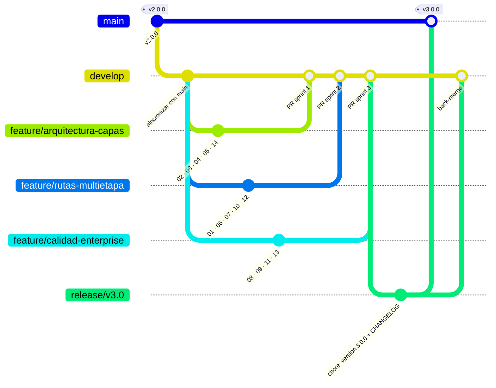

# 02 GitHub y GitFlow: Historial trazable para AquaPort Enterprise

**Nivel:** Empoleon · Conventional Commits · hook `commit-msg` · ruleset de protección de `main` y `develop` · `CHANGELOG.md` generado · tag `v3.0.0`

En Enterprise el historial de git es documentación de arquitectura: cada commit dice qué decisión se tomó y en qué punto del reto. Por eso en esta versión el formato deja de ser una convención del equipo y pasa a validarse automáticamente.

## 1. Conventional Commits validado con un hook

Formato: `tipo(alcance): descripción` con el alcance `empoleon-NN` (número del reto).

```
feat(empoleon-03): agregar cadena de validación de tramos
test(empoleon-12): red de PlanificadorRuta antes del código
fix(empoleon-13): restaurar la interrupción del hilo en ClienteHttpAPIHidrica
```

| Archivo | Qué hace |
|---|---|
| [`.githooks/commit-msg`](../.githooks/commit-msg) | Rechaza el commit si la primera línea no cumple `^(feat\|fix\|refactor\|test\|docs\|chore\|build\|ci\|perf\|style)(\(alcance\))?!?: descripción de 10+ caracteres`. Deja pasar los `Merge` y `Revert` que genera git o GitHub. |

Se activa una sola vez por clon (el `.bat` de entrega ya lo hace):

```bash
git config core.hooksPath .githooks
```

Prueba del hook:

```
$ git commit -m "arreglos varios"
Commit rechazado: el mensaje no sigue Conventional Commits.
  Recibido: arreglos varios
  Formato:  tipo(alcance): descripción de al menos 10 caracteres
```

Se usó `core.hooksPath` con una carpeta versionada (y no `.git/hooks`) para que el hook viaje con el repositorio y todo el equipo valide igual.

## 2. Protección de `main` y `develop`

[`.github/rulesets/proteger-main-develop.json`](../.github/rulesets/proteger-main-develop.json) es un ruleset de GitHub que se importa en **Settings → Rules → Rulesets → New ruleset → Import a ruleset**:

| Regla | Efecto |
|---|---|
| `pull_request` | No se puede hacer push directo: todo cambio entra por Pull Request. |
| `non_fast_forward` | Prohíbe `git push --force` (no se reescribe historia publicada). |
| `deletion` | Nadie puede borrar `main` ni `develop`. |

`required_approving_review_count` está en 0 porque en el repositorio de entrega solo hay una cuenta con permisos y GitHub no deja aprobar el PR propio. En un equipo con varios integrantes se sube a 1, que es lo que exige la Definition of Done del punto 09.

Si la importación del JSON no está disponible, la configuración manual equivalente es: **Settings → Branches → Add branch ruleset**, objetivo `main` y `develop`, activar *Restrict deletions*, *Require a pull request before merging* y *Block force pushes*.

**Pendiente:** captura de la regla activa en `evidencias/ruleset-activo.png`.

## 3. CHANGELOG generado desde los commits

[`scripts/generar-changelog.sh`](../scripts/generar-changelog.sh) lee `git log` entre dos tags, ignora los merges y agrupa los commits por tipo:

```bash
bash scripts/generar-changelog.sh v2.0.0 HEAD v3.0.0 > CHANGELOG.md
```

El `CHANGELOG.md` de la raíz se generó así en la rama `release/v3.0` y no se editó a mano. Si un commit no sigue el formato, no aparece en el changelog: otra razón para que el hook lo rechace antes.

## 4. Flujo de ramas de la v3



| Rama | Sprint de Jira | Puntos |
|---|---|---|
| `feature/arquitectura-capas` | Sprint 1: arquitectura por capas y patrones | 02, 03, 04, 05, 14 |
| `feature/rutas-multietapa` | Sprint 2: rutas multi-etapa y coordinación | 01, 06, 07, 10, 12 |
| `feature/calidad-enterprise` | Sprint 3: calidad (JaCoCo ≥ 85 %, Sonar) | 08, 09, 11, 13 |

Como `main` y `develop` quedan protegidas, también la release entra por PR: `release/v3.0 → main` y `release/v3.0 → develop` (back-merge). El tag `v3.0.0` se crea sobre el merge en `main`.

## 5. Estrategia de merge: por qué no squash en las features

| Estrategia | Dónde se usa | Por qué |
|---|---|---|
| **Merge commit** | PR de `feature/*` y de `release/*` | Conserva cada commit. El punto 12 necesita que se vean los commits Red → Green → Refactor y el 13 un commit por issue de Sonar; un squash los convertiría en uno solo y se perdería la evidencia. |
| **Squash** | PR pequeños de una sola idea (por ejemplo, corregir un README) | Deja un único commit descriptivo en `develop`. |
| **Rebase** | Local, antes de abrir el PR (`git rebase develop`) | Actualiza la feature sin commits de merge intermedios. Nunca sobre ramas ya publicadas, por la regla `non_fast_forward`. |

## 6. Log de la v3

`evidencias/git-log-empoleon.txt` tiene el `git log --oneline v2.0.0..release/v3.0` con los commits de Enterprise (más de 40, todos con formato Conventional Commits). Se genera en la release junto con el changelog.

## Versionado

| Tag | Contenido | Tipo de cambio |
|---|---|---|
| `v1.0.0` | Piplup: 4 drones, asignación manual | primera versión |
| `v2.0.0` | Prinplup: 15 drones, asignación automática | MAJOR |
| `v3.0.0` | Empoleon: 60 drones, 4 zonas, rutas multi-etapa, arquitectura por capas | **MAJOR**: los paquetes pasan a `dominio/aplicacion/infraestructura` y `Mision` se reemplaza por `MisionRuta`; el código de la v2 no compila contra la v3. |
