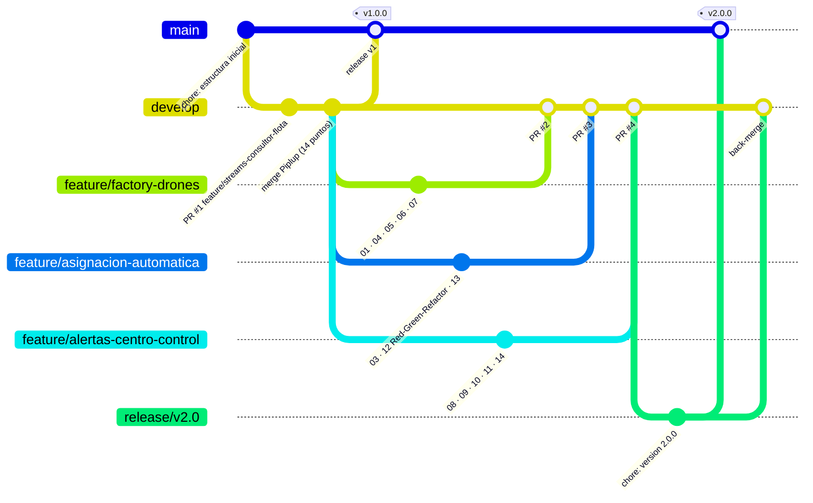

# 02 GitHub y GitFlow: Flujo completo para la versión 2

**Nivel:** Prinplup · `main` · `develop` · `feature/*` · `release/*` · `hotfix/*` · tags semánticos · Pull Requests

En Piplup se usaron `main`, `develop` y una `feature/`. En Prinplup se aplica el ciclo completo: cada bloque de trabajo sale de `develop` en su propia rama, entra por **Pull Request**, la versión se estabiliza en una rama **`release/`** y al publicarse queda marcada con un **tag**.

## Diagrama de ramas



## Para qué sirve cada rama

| Rama | Nace de | Se fusiona en | En AquaPort |
|---|---|---|---|
| `main` | - | - | Solo versiones publicadas: `v1.0.0` (Piplup) y `v2.0.0` (Prinplup). Nunca se hace commit directo. |
| `develop` | `main` | `release/*` | Integración: aquí llegan las features por PR. |
| `feature/*` | `develop` | `develop` (PR) | Un bloque de funcionalidad. Se borra después de que el profesor revise el PR. |
| `release/v2.0` | `develop` | `main` y `develop` | Congela la versión: solo ajustes de cierre (versión de los `pom.xml`, documentación). Ninguna funcionalidad nueva. |
| `hotfix/*` | `main` | `main` y `develop` | Corrección urgente sobre una versión publicada (ver abajo). |
| `Piplup` / `Prinplup` | - | - | Ramas de entrega del curso: `Prinplup` apunta al mismo commit que `v2.0.0`. |

## Las 3 features de Prinplup

| Rama | Puntos | Historias de Jira | PR |
|---|---|---|---|
| `feature/factory-drones` | 01 Streams, 04 SOLID, 05 C4, 06 RF/RNF, 07 Plantilla | HU-04, HU-10 | #2 |
| `feature/asignacion-automatica` | 03 Patrones, 12 TDD, 13 JaCoCo | HU-05, HU-06, HU-07 | #3 |
| `feature/alertas-centro-control` | 08 UX/UI, 09 Jira, 10 Casos de uso, 11 Mocks, 14 SonarQube | HU-08, HU-09 | #4 |

Las tres ramas tocan carpetas distintas, así que los PR se pueden fusionar en cualquier orden sin conflictos. Cada PR se abre contra `develop`, con título `feat: ...` y una descripción con los puntos que incluye y cómo probarlos (`mvn verify` en cada carpeta con código).

## Convención de commits

`tipo:Prinplup-Punto NN - descripción en infinitivo`, con los tipos `feat`, `test`, `refactor`, `docs` y `chore`.

```
test:Prinplup-Punto 12 - Red: pruebas de AsignadorAutomatico con Mockito
feat:Prinplup-Punto 12 - Green: AsignadorAutomatico minimo
refactor:Prinplup-Punto 12 - Refactor: extraer elegirEntre, confirmar y sinIncluir
refactor:Prinplup-Punto 14 - Sonar java:S106 y java:S2629: usar Logger con Supplier
```

## Versionado semántico

| Tag | Qué contiene | Por qué ese número |
|---|---|---|
| `v1.0.0` | MVP Piplup: 4 drones, asignación manual | Primera versión estable. |
| `v2.0.0` | Prinplup: 15 drones de 3 tipos, asignación automática, alertas | **MAJOR**: el modelo cambió de forma incompatible (`DroneAcuatico` pasó de `record` a clase abstracta, las zonas de `String` a `enum`). Un cliente de la v1 no compila contra la v2. |
| `v2.0.1` (si hiciera falta) | Hotfix | **PATCH**: corrige sin cambiar la API. |

## Hotfix (procedimiento)

Si después de publicar `v2.0.0` se encontrara, por ejemplo, que un drone con batería exactamente en 35 % no se asigna:

```bash
git checkout -b hotfix/fix-bateria-critica v2.0.0
# prueba que reproduce el error + corrección
git checkout main    && git merge --no-ff hotfix/fix-bateria-critica && git tag -a v2.0.1 -m "Hotfix bateria critica"
git checkout develop && git merge --no-ff hotfix/fix-bateria-critica
```

El hotfix nace de `main` (no de `develop`) porque `develop` puede tener trabajo sin terminar que no debe salir con la corrección.

## Errores evitados

1. **Ningún commit directo en `main` ni en `develop`**: todo entra por merge de `feature/` (PR) o de `release/`.
2. **La release no trae funcionalidad nueva**, solo el cierre de la versión.
3. **Back-merge de la release a `develop`**: si no se hace, el cambio de versión del `pom.xml` se pierde en la siguiente release.
4. **Ramas `feature/` cortas y con un tema**: un PR de 14 puntos no se puede revisar.
5. `.gitignore` de Piplup se mantiene: `target/`, `*.class` e IDE fuera del repositorio.
