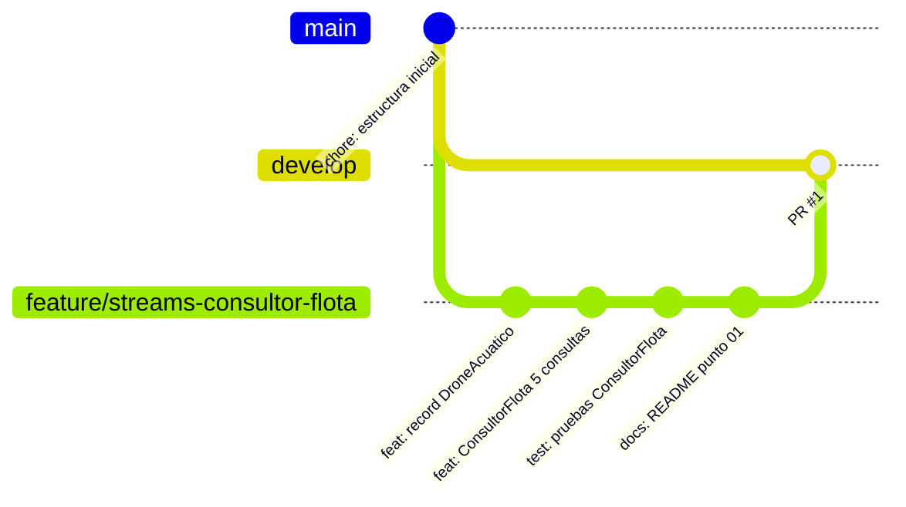

# 02 GitHub y GitFlow: Repositorio de AquaPort con estructura GitFlow básica

**Nivel:** Piplup · `main` · `develop` · `feature/` · commits atómicos · `.gitignore`

## Ramas

```
main                              → código que "vive en producción"
└── develop                       → integración continua del trabajo
    └── feature/streams-consultor-flota   → código del reto 01 (ConsultorFlota)
        └── Piplup                → rama de entrega del equipo con los 14 puntos
```



## `.gitignore` (raíz del repositorio)

Excluye lo que **no** es código fuente: `target/`, `*.class`, `.idea/`, `*.iml`, `.vscode/`, `.settings/`, `.classpath`, `.project`, `out/`, `*.log`, `.DS_Store`. Así el repositorio no se llena de compilados ni de configuración personal del IDE.

## Commits atómicos de la rama `feature/streams-consultor-flota`

| # | Mensaje | Qué contiene (una sola cosa) |
|---|---|---|
| 1 | `feat:Piplup-Punto 01 - Agregar record DroneAcuatico y pom del proyecto` | Modelo del dominio + `pom.xml` |
| 2 | `feat:Piplup-Punto 01 - Implementar ConsultorFlota con 5 consultas Stream` | `ConsultorFlota` + `main` que imprime las consultas |
| 3 | `test:Piplup-Punto 01 - Agregar pruebas de ConsultorFlota` | `ConsultorFlotaTest` (10 pruebas) |
| 4 | `docs:Piplup-Punto 01 - Documentar las consultas en el README` | `README.md` del punto 01 |

Formato: `tipo:Piplup-Punto NN - descripción en presente` (convención del equipo, igual que en Chimchar). Tipos: `feat`, `test`, `refactor`, `docs`, `chore`.

| Commit correcto | Commit incorrecto |
|---|---|
| `feat:Piplup-Punto 01 - Implementar ConsultorFlota con 5 consultas Stream` | `cambios`, `arreglé cosas`, `wip`, `asdf` |

## Pull Request

Repositorio: https://github.com/SantiagoAndresGarciaAlmario01/Refuerzo-Corte2-Equipo-Piplup

En GitHub: **Pull requests > New pull request**, base `develop`, compare `feature/streams-consultor-flota`, título `feat: ConsultorFlota con 5 consultas Stream (reto 01)`, luego **Create pull request** y **Merge pull request** (sin borrar la rama hasta que el profesor lo revise).

PR: https://github.com/SantiagoAndresGarciaAlmario01/Refuerzo-Corte2-Equipo-Piplup/pull/1

## Los 3 errores evitados

1. **Nunca se trabajó directo en `main`**: todo nace en `feature/` y entra por PR a `develop`.
2. **Sin commits gigantes**: cada commit agrega una sola cosa (modelo, lógica, pruebas, documentación).
3. **Sin `target/`, `.class` ni `.idea/` en el repositorio** gracias al `.gitignore`.
