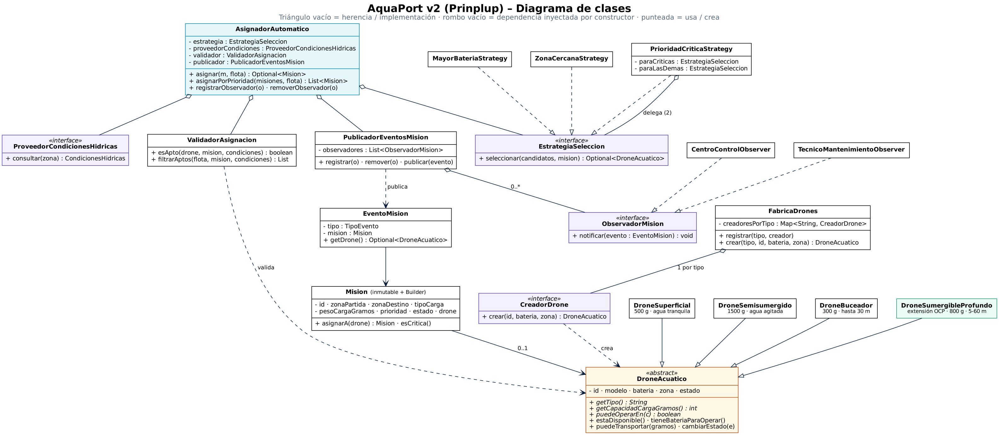

# 04 Principios SOLID: Auditoría del diseño de AquaPort v2

**Nivel:** Prinplup · **Principios:** SRP · OCP · LSP · ISP · DIP · **Prueba de extensión:** `DroneSumergibleProfundo`

## Diagrama de clases



Fuente: [`docs/diagrama-clases-v2.dot`](docs/diagrama-clases-v2.dot) (Graphviz: `dot -Tpng docs/diagrama-clases-v2.dot -o docs/diagrama-clases-v2.png`). En verde está el cuarto tipo agregado para demostrar OCP.

## Auditoría por clase

| Clase | Principio que aplica | Cómo se ve en el código | Qué pasaría si no se cumpliera |
|---|---|---|---|
| `AsignadorAutomatico` | **DIP** + **SRP** | Recibe por constructor `EstrategiaSeleccion`, `ProveedorCondicionesHidricas`, `ValidadorAsignacion` y `PublicadorEventosMision`. Solo coordina: consulta condiciones, filtra aptos, delega la elección y confirma. | Si creara `new MayorBateriaStrategy()` o llamara a la API real, no se podría probar sin red ni cambiar la política sin editarlo. |
| `ValidadorAsignacion` | **SRP** | Única responsabilidad: decidir si un drone es apto (disponible, batería ≥ 35 %, capacidad, condiciones hídricas). | Las reglas de aptitud estarían repartidas entre asignador, estrategias y UI. |
| `EstrategiaSeleccion` y sus 3 implementaciones | **OCP** + **ISP** | Una interfaz de un método; una política nueva es una clase nueva. | Cada criterio nuevo sería otro `if` dentro del asignador. |
| `PublicadorEventosMision` | **SRP** | Solo mantiene la lista de observadores y reparte los eventos. | El asignador cargaría con la lista de suscriptores además de su lógica. |
| `ObservadorMision` | **ISP** + **OCP** | Un solo método `notificar(EventoMision)`. Un nuevo interesado (por ejemplo un registro de auditoría) se agrega sin tocar a nadie. | Una interfaz con `onAsignada`, `onFallo`, `onSinDrone`, ... obligaría al técnico a implementar métodos que no usa. |
| `ProveedorCondicionesHidricas` | **DIP** + **ISP** | Abstracción de la API externa de condiciones hídricas (sistema externo del C4). | El dominio quedaría acoplado a HTTP y a un proveedor concreto. |
| `FabricaDrones` + `CreadorDrone` | **OCP** | Registro `Map<String, CreadorDrone>`; un tipo nuevo se registra con `Tipo::new`. | Un `switch (tipo)` que habría que modificar por cada drone nuevo. |
| `DroneAcuatico` y subclases | **LSP** + **OCP** | Cada subtipo responde `getCapacidadCargaGramos()` y `puedeOperarEn(condiciones)` con sus propias reglas, sin lanzar excepciones ni cambiar el contrato. | `if (drone instanceof DroneBuceador)` repartidos por el código. |
| `Mision` (inmutable + Builder) | **SRP** | Solo representa la misión y valida sus invariantes en `build()`. `asignarA(drone)` devuelve una misión nueva. | Misiones en estado inválido circulando por el sistema. |
| `ConsultorFlota` | **SRP** | Solo consultas de lectura con Streams; no modifica la flota. | Consultas mezcladas con la lógica de asignación. |

## OCP demostrado: un cuarto tipo sin modificar el asignador

Se agregó `DroneSumergibleProfundo` (800 g, de 5 a 60 m, solo agitación baja). Los cambios fueron:

| Archivo | Cambio |
|---|---|
| `modelo/DroneSumergibleProfundo.java` | **Nuevo** (extiende `DroneAcuatico`) |
| `AsignadorAutomatico`, `ValidadorAsignacion`, estrategias, observadores | **Ninguno** |
| `FabricaDrones` | **Ninguno**: el tipo se registra desde afuera con `fabrica.registrar(DroneSumergibleProfundo.TIPO, DroneSumergibleProfundo::new)` |

La prueba `ocp_nuevoTipoDeDrone_seAsignaSinCambiarElAsignador` pide una misión de 600 g a 20 m de profundidad: el buceador (300 g) no puede llevarla y el asignador, sin cambios, elige el `AR-16` sumergible profundo.

## LSP

`lsp_cualquierSubtipo_cumpleElContratoDelPadre` es una prueba parametrizada que corre sobre los **4** subtipos. Todos responden `puedeOperarEn` y `puedeTransportar` sin excepciones y con capacidad positiva. Las precondiciones del padre (id obligatorio, batería 0–100) están en el constructor de `DroneAcuatico` y ningún hijo las endurece.

## DIP

`dip_asignadorDependeDeAbstracciones` construye el asignador solo con **mocks** de `EstrategiaSeleccion`, `ProveedorCondicionesHidricas` y `ObservadorMision`. Si el asignador dependiera de clases concretas esta prueba no se podría escribir.

## Decisiones discutidas

- **`asignarPorPrioridad` usa un `for`**: cada asignación cambia el estado del drone a `EN_MISION` y afecta la siguiente. Hacerlo con `stream().map(...)` sería un stream con efectos secundarios, que es justamente lo que el revisor prohíbe. Las consultas puras sí están en Streams.
- **Estado del drone mutable**: un drone físico cambia de estado durante el día; el cambio está encapsulado en `cambiarEstado` y validado (no acepta `null`).
- Ninguna clase supera 150 líneas y ningún método supera 20 líneas.

## Pruebas (27)

`PrincipiosSolidTest` (OCP, LSP x4, DIP) y `DroneAcuaticoTest` (reglas de cada tipo, incluido el sumergible profundo).

```bash
mvn test
```
