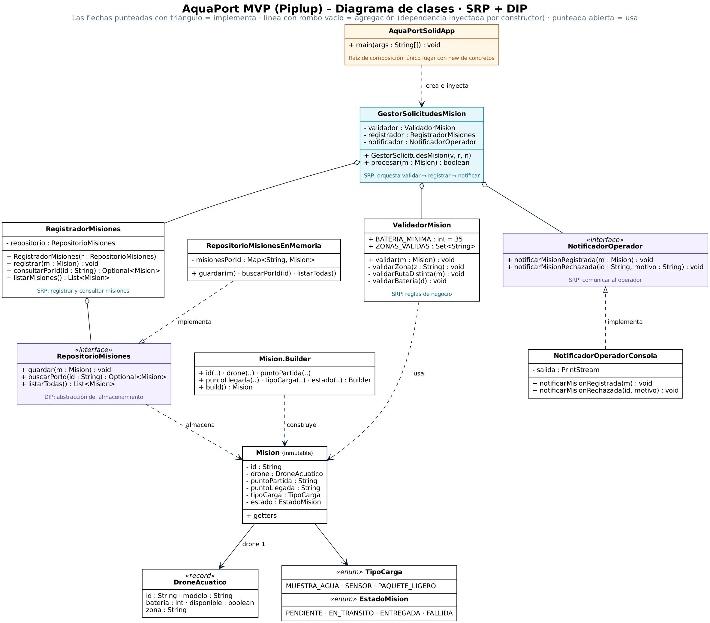

# 04 Principios SOLID: SRP y DIP en el núcleo de AquaPort MVP

**Nivel:** Piplup · **Principios:** S (Responsabilidad Única) · D (Inversión de Dependencias)

## 1. Diagnóstico del código original

```java
class GestorMision {
    public void registrarMision(Mision m) { /* guarda en lista */ }
    public void enviarNotificacionEmail(Mision m) { /* envía email */ }
    public void calcularRutaOptima(Mision m) { /* lógica de ruta */ }
    public void imprimirReporte() { /* formatea e imprime */ }
}
```

`GestorMision` viola **SRP** porque tiene **4 razones para cambiar**:

| Si cambia… | …hay que tocar `GestorMision` |
|---|---|
| la forma de guardar (lista → archivo → BD) | `registrarMision` |
| el canal de aviso (email → pantalla → SMS) | `enviarNotificacionEmail` |
| el algoritmo de rutas | `calcularRutaOptima` |
| el formato del reporte | `imprimirReporte` |

Consecuencia real: un cambio en el formato del reporte obliga a recompilar y volver a probar el registro de misiones, y dos personas que trabajan en temas distintos editan el mismo archivo (conflictos de merge).

Y `AsignadorMision` con `private BaseDatosLocal bd = new BaseDatosLocal();` viola **DIP**: la lógica de negocio queda amarrada a un almacenamiento concreto y no se puede probar sin él.

## 2. Diseño propuesto



| Clase | Única responsabilidad (una razón para cambiar) |
|---|---|
| `RegistradorMisiones` | Registrar y consultar misiones (rechaza ids duplicados). |
| `ValidadorMision` | Reglas de negocio: zonas fijas, partida ≠ llegada, batería ≥ 35 %. |
| `NotificadorOperador` *(interfaz)* + `NotificadorOperadorConsola` | Comunicar resultados al operador. |
| `RepositorioMisiones` *(interfaz)* + `RepositorioMisionesEnMemoria` | Almacenar misiones. |
| `GestorSolicitudesMision` | Orquestar el flujo *validar → registrar → notificar*; no contiene reglas, ni almacenamiento, ni formato. |
| `AquaPortSolidApp` | Raíz de composición: el **único** lugar donde se hace `new` de clases concretas. |

### Interfaz `RepositorioMisiones`

```java
public interface RepositorioMisiones {
    void guardar(Mision mision);
    Optional<Mision> buscarPorId(String id);   // nunca null
    List<Mision> listarTodas();
}
```

### Constructor injection en `RegistradorMisiones`

```java
public RegistradorMisiones(RepositorioMisiones repositorio) {
    this.repositorio = Objects.requireNonNull(repositorio, "El repositorio de misiones es obligatorio");
}
```

## 3. Justificación

- **SRP:** cada clase cambia por un solo motivo. Si mañana el operador recibe avisos en pantalla en vez de consola, se crea `NotificadorOperadorPantalla` y no se toca ni el validador ni el registrador.
- **DIP:** `RegistradorMisiones` depende de `RepositorioMisiones` (abstracción) y `GestorSolicitudesMision` depende de `NotificadorOperador` (abstracción). Las dependencias llegan **por constructor**, son `final` y se validan contra `null`, así el objeto nunca queda a medio construir.
- **Testabilidad (beneficio directo de DIP):** en `GestorSolicitudesMisionTest` se usa un `NotificadorEspia` (doble de prueba) en lugar de la consola; el gestor no nota la diferencia.
- **OCP como efecto secundario:** agregar un canal o un almacenamiento nuevo es *agregar una clase*, no modificar las existentes.
- **Sin `null`:** las búsquedas devuelven `Optional`.

## 4. Ejecución de ejemplo

```
[OK] Misión M-001 registrada: drone AR-01 | Embalse Norte -> Laboratorio Hídrico
[RECHAZADA] Misión M-002: El drone AR-02 tiene batería insuficiente (30%). Mínimo requerido: 35%.
[RECHAZADA] Misión M-003: La zona 'Zona Desconocida' no pertenece a las zonas fijas del campus
Misiones registradas: 1
```

## 5. Archivos

- `src/main/java/...`: código (modelo reutilizado del punto 03).
- `src/test/java/...`: 6 pruebas (misión válida, batería insuficiente, zona inválida, ruta circular, id duplicado, búsqueda inexistente → `Optional.empty()`).
- `docs/diagrama-clases-solid.png` y su fuente editable `docs/diagrama-clases-solid.dot` (Graphviz: `dot -Tpng diagrama-clases-solid.dot -o diagrama-clases-solid.png`).
