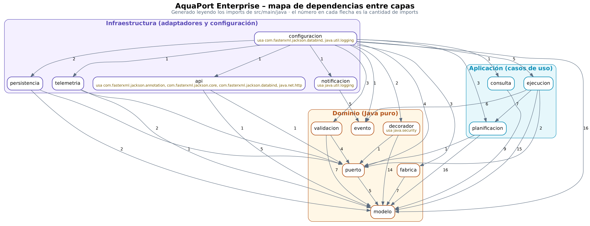

# 04 Principios SOLID: Auditoría de la arquitectura Enterprise

**Nivel:** Empoleon · **Regla de oro:** el paquete `dominio` no importa ninguna librería externa · **Código auditado:** el proyecto completo de [`14 Arquitectura por Capas`](../14%20Arquitectura%20por%20Capas/)

## Cómo se auditó

| Técnica | Qué revisa | Resultado |
|---|---|---|
| Revisión manual de imports con `grep` ([`scripts/auditar-capas.sh`](scripts/auditar-capas.sh)) | Imports de cada capa, `new` de infraestructura fuera de infraestructura, campos no `final` y setters en servicios | 0 violaciones ([reporte](../14%20Arquitectura%20por%20Capas/docs/reporte-dependencias.txt)) |
| Prueba automática `ArquitecturaCapasTest` (punto 14) | Las mismas reglas, pero como prueba JUnit: si alguien rompe una capa, falla `mvn test` | 4/4 en verde |
| SonarQube (punto 13) | Issues de diseño y mantenibilidad sobre el mismo código | Los issues encontrados y su corrección están en el punto 13 |
| Lectura clase por clase | Una razón para cambiar, extensión sin modificación, contratos de subtipos | tabla de abajo |

```bash
bash scripts/auditar-capas.sh            # se ejecuta desde "14 Arquitectura por Capas"
```

## Mapa de dependencias entre capas



Generado leyendo los imports reales de `src/main/java` (fuente: [`docs/mapa-dependencias.dot`](docs/mapa-dependencias.dot)). Todas las flechas van hacia adentro:

```
infraestructura ──▶ aplicacion ──▶ dominio
        └─────────────────────────────▲
```

| Capa | Puede importar | Importa realmente | Librerías externas |
|---|---|---|---|
| `dominio` | `java.*` y `dominio.*` | `java.util`, `java.nio`, `java.security` (SHA-256 del sello) | **ninguna** |
| `aplicacion` | además `dominio.*` | `dominio.*`, `java.util` | ninguna |
| `infraestructura` | todo | `aplicacion.*`, `dominio.*`, Jackson, `java.net.http`, `java.util.logging` | Jackson (en `infraestructura.api` y en la raíz de composición que crea el `ObjectMapper`) |

## Auditoría por principio

| Principio | Dónde se respeta | Por qué importa en AquaPort |
|---|---|---|
| **S** · Responsabilidad única | `PlanificadorRuta` solo elige drones por tramo; `DesviadorRuta` solo reemplaza tramos adversos; `ReasignadorTramo` solo decide si un drone sigue o se reemplaza; `EjecutorRuta` solo recorre y custodia; `ServicioMisionMultiEtapa` solo coordina el caso de uso. | En Prinplup un solo `AsignadorAutomatico` hacía todo. Con rutas multi-etapa esa clase habría pasado de 150 líneas; separada, cada flujo alterno tiene una clase donde vive y una prueba que la cubre. |
| **O** · Abierto/cerrado | Un validador nuevo es una subclase de `EslabonValidacion` y una línea en `CadenaValidacion`; un decorador nuevo extiende `DroneDecorador`; un tipo de drone nuevo se registra en `FabricaDrones`; un observador nuevo implementa `ObservadorRuta`. | Ninguna de estas extensiones toca `PlanificadorRuta` ni `EjecutorRuta`, que son las clases con más pruebas y más riesgo de regresión. |
| **L** · Sustitución de Liskov | `DroneConMonitoreo` y `DroneConCifrado` implementan `Drone` y se usan donde se espera un `Drone`; los 3 tipos de `DroneAcuatico` responden `puedeOperarEn` sin excepciones. `FlujoMultiEtapaIntegracionTest` corre todo el flujo con drones decorados. | Si un decorador lanzara una excepción en `getBateria()` o cambiara el resultado del tramo, la cadena de validación o la custodia fallarían en producción y no en compilación. |
| **I** · Segregación de interfaces | Puertos de un método: `ProveedorCondicionesHidricas.consultar`, `EstadoZonas.estaActiva`, `RegistroTelemetria.registrar`, `ObservadorRuta.notificar`, `CriterioAptitud.esApto`. `RepositorioMisiones` tiene 3 métodos y todos los usa su implementación. | Las pruebas simulan exactamente lo que cada clase necesita (un `when(...)` por puerto) y ninguna implementación queda con métodos vacíos o `UnsupportedOperationException`. |
| **D** · Inversión de dependencias | El dominio define los puertos (`dominio.puerto`) y la infraestructura los implementa (`AdaptadorAPIHidrica`, `EstadoZonasEnMemoria`, `RepositorioMisionesEnMemoria`, `RegistroTelemetriaEnMemoria`). Todo se inyecta por constructor en `ConfiguracionAquaPort`, la única raíz de composición. | Pasar de memoria a PostgreSQL o de la API simulada a la real es cambiar una clase de infraestructura y una línea en la configuración. El dominio y la aplicación ni se recompilan por razones de infraestructura. |

## Verificaciones específicas del reto

| Verificación | Cómo se comprobó | Resultado |
|---|---|---|
| Ninguna clase del dominio depende de infraestructura | Regla 1 del script y `dominio_noDependeDeNadaExterno` | 0 imports fuera de `java.*`/`dominio.*` |
| Todos los servicios reciben dependencias por constructor | Regla 4 del script y `aplicacion_camposFinales`: todos los campos de `aplicacion` son `private final` y se asignan en el constructor con `Objects.requireNonNull` | 0 campos mutables, 0 setters |
| No hay `new ClaseInfraestructura()` en el dominio | Regla 3 del script y `capasInternas_noInstancianInfraestructura` | 0 ocurrencias |

## Decisiones discutidas

- **`EslabonValidacion.siguiente` no es `final`**: el patrón Chain enlaza los eslabones después de crearlos (`enlazar`). Está en el dominio, no en un servicio de aplicación, y solo se modifica al armar la cadena en `CadenaValidacion`.
- **`DroneAcuatico` es mutable** (batería, zona y estado): representa un equipo físico que se mueve y se descarga. `MisionRuta`, `Tramo`, `PlanRuta`, `ResultadoTramo` y los registros de custodia sí son inmutables.
- **`SelloCustodia` usa `java.security.MessageDigest`**: es parte del JDK, no una dependencia externa, así que el dominio sigue siendo “solo Java”.
- **`EjecutorRuta.ejecutar` usa un `for`**: recorrer la ruta cambia estados de drones y alimenta la custodia en orden estricto; hacerlo con un stream sería un stream con efectos secundarios.

## Métricas de tamaño (nivel Empoleon)

72 clases en `src/main/java`; la más grande es `MisionRuta` con 141 líneas (límite 150) y ningún método supera 15 líneas.
