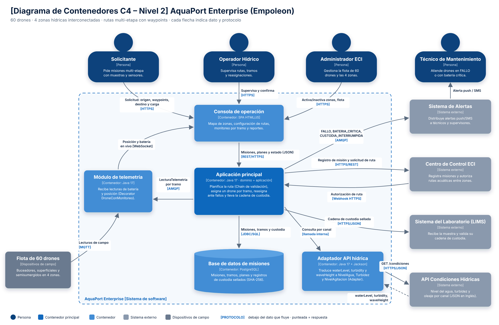

# 05 Diagrama C4 nivel 2: Contenedores de AquaPort Enterprise

**Nivel:** Empoleon · **C4 Nivel 2 (Container)** · cada flecha indica el dato que fluye y el protocolo

Archivos: `docs/c4-contenedores-empoleon.png` (entregable) y `docs/c4-contenedores-empoleon.svg` (fuente vectorial).

## Por qué nivel 2

El nivel 1 de Prinplup mostraba a AquaPort como una sola caja. Con 60 drones, telemetría continua y una cadena de custodia que se entrega a otro sistema, la pregunta ya no es solo “con quién habla AquaPort” sino “qué piezas desplegables lo componen y cómo se comunican”. Eso es el nivel 2.

## Contenedores

| Contenedor | Tecnología | Responsabilidad | En el código |
|---|---|---|---|
| **Consola de operación** | SPA HTML/JS | Mapa de zonas, configuración de rutas, monitoreo por tramo, reportes de custodia | mocks de los puntos 08 y 11 |
| **Aplicación principal** | Java 17 (dominio + aplicación) | Planifica la ruta con la cadena de validación, asigna un drone por tramo, reasigna ante fallos y lleva la custodia | `dominio.*`, `aplicacion.*` |
| **Módulo de telemetría** | Java 17 | Recibe lecturas de los drones y del Decorator `DroneConMonitoreo`; publica posición y batería en vivo | `RegistroTelemetria` (puerto) y `infraestructura.telemetria` |
| **Adaptador API hídrica** | Java 17 + Jackson | Traduce el JSON en inglés del proveedor al modelo del dominio | `infraestructura.api.AdaptadorAPIHidrica` |
| **Base de datos de misiones** | PostgreSQL | Misiones, tramos, planes y registros de custodia sellados | `RepositorioMisiones` (puerto); hoy `RepositorioMisionesEnMemoria` |

## Sistemas externos (4) y dispositivos

| Elemento | Qué intercambia con AquaPort |
|---|---|
| **API Condiciones Hídricas** | `GET /condiciones?desde&hasta` → `waterLevel`, `turbidity`, `waveHeight` por canal |
| **Centro de Control ECI** | Recibe el registro de misión y la solicitud de ruta; responde la autorización por webhook |
| **Sistema de Alertas** | Recibe eventos `FALLO`, `BATERIA_CRITICA_EN_RUTA`, `CUSTODIA_INTERRUMPIDA` y los reparte por push/SMS |
| **Sistema del Laboratorio (LIMS)** | Recibe la cadena de custodia sellada al entregar la muestra |
| Flota de 60 drones (dispositivos de campo) | Envía lecturas de batería y posición por MQTT |

## Comunicaciones (dato + protocolo)

| Desde → Hacia | Dato | Protocolo |
|---|---|---|
| Personas → Consola | Solicitudes, supervisión, gestión de zonas y flota | HTTPS |
| Consola → Aplicación | Misiones, planes y estado (JSON) | REST/HTTPS |
| Telemetría → Consola | Posición y batería en vivo | WebSocket |
| Aplicación → Base de datos | Misiones, tramos y custodia | JDBC/SQL |
| Aplicación → Telemetría | `LecturaTelemetria` por tramo | AMQP |
| Drones → Telemetría | Lecturas de campo | MQTT |
| Aplicación → Adaptador | Consulta de condiciones por canal | llamada interna |
| Adaptador → API Condiciones Hídricas | `GET /condiciones` y respuesta JSON | HTTPS/JSON |
| Aplicación ↔ Centro de Control | Registro de misión / autorización de ruta | HTTPS/REST y webhook HTTPS |
| Aplicación → Sistema de Alertas | Eventos de fallo, batería crítica y custodia | AMQP |
| Aplicación → LIMS | Cadena de custodia sellada | HTTPS/JSON |
| Sistema de Alertas → Técnico | Alerta | push / SMS |

## Decisiones

- **Asíncrono (AMQP) para alertas y telemetría**: un fallo en el Sistema de Alertas no debe detener una ruta en curso. Las consultas que la aplicación necesita para decidir (condiciones del canal, autorización de ruta) son síncronas.
- **El adaptador es un contenedor propio**: se despliega aparte porque depende de un proveedor externo con sus propios tiempos de respuesta y cambios de formato; si el proveedor cambia, solo se redespliega el adaptador.
- **Los drones no son un sistema externo** sino dispositivos de campo del propio sistema; se dibujan con otro color.
- No se dibujan clases ni paquetes: eso es nivel 3 (el mapa de dependencias del punto 04 cumple ese papel).
