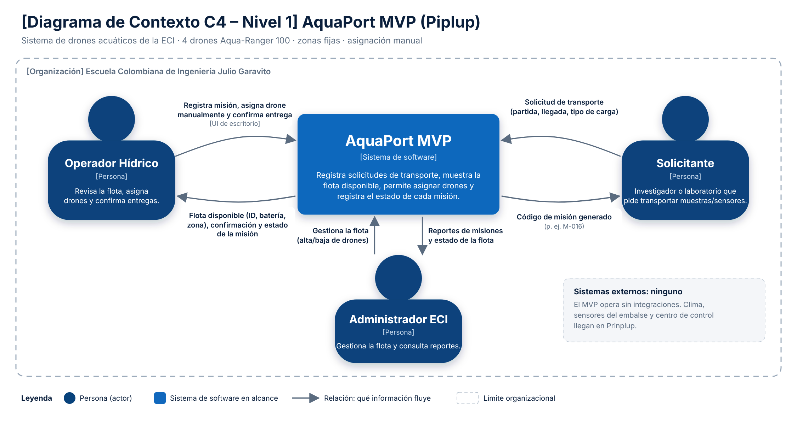

# 05 Diagrama de Contexto C4: ¿Qué es AquaPort MVP y quién interactúa con él?

**Nivel:** Piplup · **C4 Nivel 1 (System Context)**

Archivos: `docs/c4-contexto-piplup.png` (entregable) y `docs/c4-contexto-piplup.svg` (fuente vectorial editable).

## Elementos

| Tipo | Elemento | Descripción |
|---|---|---|
| Sistema | **AquaPort MVP** | Registra solicitudes de transporte, muestra la flota disponible, permite asignar drones y registra el estado de cada misión. |
| Persona | **Operador Hídrico** | Revisa la flota, asigna drones manualmente y confirma entregas. |
| Persona | **Solicitante** | Investigador o laboratorio que pide transportar muestras de agua o sensores. |
| Persona | **Administrador ECI** | Gestiona la flota y consulta reportes. |
| Sistema externo | *Ninguno* | El MVP opera sin integraciones externas. |

## Relaciones (qué información fluye)

| Desde | Hacia | Dato que fluye |
|---|---|---|
| Operador Hídrico | AquaPort MVP | Registro de misión, asignación manual de drone, confirmación de entrega |
| AquaPort MVP | Operador Hídrico | Flota disponible (ID, batería, zona), confirmación de asignación y estado de la misión |
| Solicitante | AquaPort MVP | Solicitud de transporte (partida, llegada, tipo de carga) |
| AquaPort MVP | Solicitante | Código de misión generado (p. ej. M-016) |
| Administrador ECI | AquaPort MVP | Gestión de flota (alta/baja de drones) |
| AquaPort MVP | Administrador ECI | Reportes de misiones y estado de la flota |

## Justificación de las decisiones

- **Caja negra:** el sistema aparece como una sola caja; no se muestran clases, paquetes ni base de datos (eso es nivel 2 y 3 de C4).
- **Actores como roles, no personas:** “Operador Hídrico”, no “Laura”.
- **Cada flecha tiene un dato concreto**, no un verbo genérico como “usa”. Se dibujan en ambos sentidos porque la información fluye de ida y de vuelta.
- **Los drones no son un sistema externo:** en el MVP la flota es el dominio que AquaPort gestiona, no un software independiente con el que se integra.
- **Se declara explícitamente que no hay sistemas externos** para que quede claro que no es un olvido: clima, sensores del embalse y centro de control llegan en Prinplup.
- **Límite organizacional (ECI)** punteado: todos los actores son internos a la Escuela.
- Notación C4 estándar: personas en azul oscuro `#08427B`, sistema en alcance `#1168BD`, leyenda incluida.
