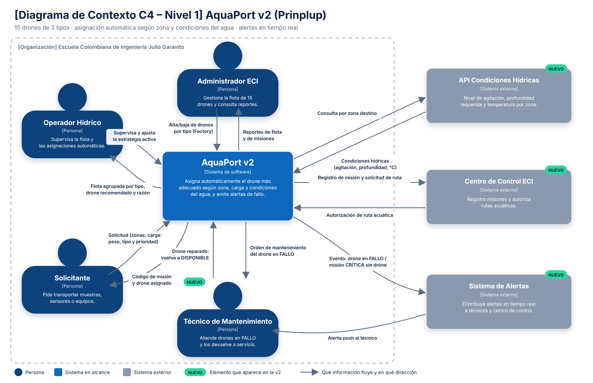

# 05 Diagrama de Contexto C4: AquaPort v2 y sus nuevas integraciones

**Nivel:** Prinplup · **C4 Nivel 1 (System Context)**

Archivos: `docs/c4-contexto-prinplup.png` (entregable), `docs/c4-contexto-prinplup.svg` (fuente vectorial) y `docs/c4-contexto-piplup-v1.png` (versión anterior, para comparar).

## Elementos

| Tipo | Elemento | Descripción | ¿Nuevo en v2? |
|---|---|---|---|
| Sistema | **AquaPort v2** | Asigna automáticamente el drone más adecuado según zona, carga y condiciones del agua, y emite alertas de fallo. | Cambia su responsabilidad |
| Persona | **Operador Hídrico** | Ya no asigna a mano: supervisa la flota y ajusta la estrategia activa. | Cambia su rol |
| Persona | **Solicitante** | Pide transportar muestras, sensores o equipos indicando peso, tipo y prioridad. | Igual, con más datos |
| Persona | **Administrador ECI** | Gestiona la flota de 15 drones por tipo y consulta reportes. | Igual |
| Persona | **Técnico de Mantenimiento** | Atiende los drones en FALLO y los devuelve a servicio. | **Sí** |
| Sistema externo | **API Condiciones Hídricas** | Entrega agitación, profundidad requerida y temperatura por zona. | **Sí** |
| Sistema externo | **Centro de Control ECI** | Registra misiones y autoriza rutas acuáticas. | **Sí** |
| Sistema externo | **Sistema de Alertas** | Distribuye alertas en tiempo real a técnicos y centro de control. | **Sí** |

## Relaciones nuevas (qué información fluye)

| Desde | Hacia | Dato |
|---|---|---|
| AquaPort v2 | API Condiciones Hídricas | Consulta por zona destino |
| API Condiciones Hídricas | AquaPort v2 | Agitación, profundidad, temperatura |
| AquaPort v2 | Centro de Control ECI | Registro de misión y solicitud de ruta |
| Centro de Control ECI | AquaPort v2 | Autorización de ruta acuática |
| AquaPort v2 | Sistema de Alertas | Evento: drone en FALLO o misión CRÍTICA sin drone |
| Sistema de Alertas | Técnico de Mantenimiento | Alerta push |
| AquaPort v2 | Técnico de Mantenimiento | Orden de mantenimiento del drone en FALLO |
| Técnico de Mantenimiento | AquaPort v2 | Drone reparado, vuelve a DISPONIBLE |
| AquaPort v2 | Operador Hídrico | Flota agrupada por tipo, drone recomendado y la razón |

## Comparación v1 → v2

| Aspecto | Piplup (v1) | Prinplup (v2) |
|---|---|---|
| Sistemas externos | Ninguno (declarado explícitamente) | 3: condiciones hídricas, centro de control y alertas |
| Personas | 3 | 4 (entra el técnico) |
| Quién decide el drone | El operador | El sistema (Strategy); el operador supervisa |
| Información que entra | Partida, llegada, tipo de carga | Además peso, prioridad y condiciones del agua |

**Qué se mantuvo:** el límite de la organización ECI, AquaPort como una sola caja negra, los actores como roles y las flechas con dato concreto en ambos sentidos.

**Qué creció:** el sistema dejó de ser autónomo. Para elegir bien el drone necesita información que no produce (el estado del agua) y para avisar de fallos necesita a otros sistemas. Por eso la v2 tiene más flechas hacia afuera que la v1.

## Justificación de las decisiones

- **Los tres sistemas externos quedan fuera del límite ECI**: AquaPort no los construye ni los controla, solo se integra con ellos. En el código esto se refleja en `ProveedorCondicionesHidricas` (interfaz) y en los observadores; el dominio no conoce al proveedor concreto.
- **El Técnico de Mantenimiento es persona, no sistema**: recibe la alerta y actúa sobre el drone físico.
- **Los drones siguen sin ser sistema externo**: son el dominio que AquaPort gestiona.
- **Etiqueta NUEVO** en cada elemento que aparece en la v2, para que la evolución se vea sin comparar dos imágenes.
- No se dibujan patrones, clases ni base de datos (eso es nivel 2 y 3).
