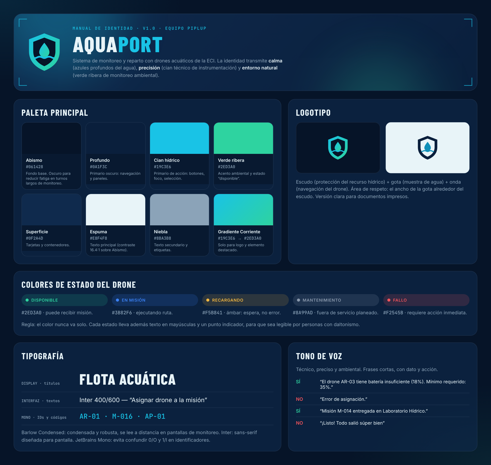

# 08 Manual de Identidad y UX/UI: Identidad primero, mock después

**Nivel:** Piplup

Orden de trabajo seguido: **1) identidad → 2) mock con IA derivado de la identidad → 3) verificación con Nielsen.**

## 1. Manual de identidad



Fuente editable: `mock/manual-identidad.html` (se abre en cualquier navegador; las fuentes van incluidas en `mock/fuentes/`).

### Paleta (con justificación)

| Rol | Nombre | Hex | Por qué |
|---|---|---|---|
| Fondo base | Abismo | `#061428` | Azul casi negro del agua profunda: transmite calma y reduce la fatiga visual en turnos largos de monitoreo. |
| Primario oscuro | Profundo | `#0A1F3C` | Navegación y paneles; mantiene la familia del agua. |
| Primario de acción | Cian hídrico | `#19C3E6` | Cian técnico de instrumentación: precisión. Se reserva para lo que se puede pulsar o lo seleccionado. Contraste 8.8:1 sobre el fondo. |
| Acento ambiental | Verde ribera | `#2ED3A0` | Monitoreo ambiental y vegetación de ribera; también es el color de “disponible”. |
| Superficie | Superficie | `#0F2A4D` | Tarjetas y contenedores. |
| Texto principal | Espuma | `#E8F4F8` | Contraste 16.4:1 sobre Abismo (supera AAA). |
| Texto secundario | Niebla | `#8BA3B8` | Contraste 7.1:1 (AA y AAA para texto normal). |
| Destacado | Gradiente Corriente | `#19C3E6 → #2ED3A0` | Solo logo y el elemento recomendado, para que no pierda fuerza. |

### Colores de estado (críticos para el operador)

| Estado | Color | Hex |
|---|---|---|
| DISPONIBLE | Verde | `#2ED3A0` |
| EN MISIÓN | Azul | `#3B82F6` |
| RECARGANDO | Ámbar | `#F5B841` |
| MANTENIMIENTO | Gris | `#8A99AD` |
| FALLO | Rojo | `#F2545B` |

Regla: **el color nunca va solo**; cada estado lleva texto en mayúsculas y un punto indicador (accesible para personas con daltonismo).

### Tipografía

| Uso | Fuente | Por qué |
|---|---|---|
| Títulos (display) | **Barlow Condensed** 700/800 | Condensada y robusta: se lee a distancia en pantallas de monitoreo. |
| Interfaz | **Inter** 400–700 | Sans-serif moderna diseñada para pantalla. |
| IDs y códigos | **JetBrains Mono** | Monoespaciada: no se confunden 0/O ni 1/l en `AR-01` o `M-016`. |

### Logotipo

Escudo (protección del recurso hídrico) + gota (muestra de agua) + onda (navegación del drone), con versión clara para impresos.

### Tono de voz

Técnico, preciso y ambiental. Frases cortas con dato y acción:
Correcto: “El drone AR-03 tiene batería insuficiente (18 %). Mínimo requerido: 35 %.” · Incorrecto: “Error de asignación.”

## 2. Mock del “Panel de monitoreo de la flota acuática”


Archivo: `mock/panel-flota.html` (muestra los 4 drones con su estado actual). Los otros estados del panel (alerta, vacío y modal de asignación) se desarrollan en el punto **11 Mocks con IA**.

## 3. Verificación con las heurísticas de Nielsen (cumple 8 de 10)

| # | Heurística | Cómo la cumple el mock |
|---|---|---|
| 1 | Visibilidad del estado del sistema | Cada drone muestra estado, batería en % y barra, zona y “hace 12 s”. Indicador “EN VIVO” con punto pulsante y KPIs (operables, batería promedio, en misión, alertas). |
| 2 | Relación con el mundo real | Vocabulario del dominio: zonas reales del campus, “muestra de agua”, “recargando”, códigos AR-XX y M-XXX. |
| 3 | Control y libertad del usuario | Botón “Detalle” en cada drone y “Cancelar” en el modal de asignación (punto 11). |
| 4 | Consistencia y estándares | Mismos colores de estado en la tarjeta, el ranking y el modal; mismo botón primario en toda la pantalla. |
| 5 | Prevención de errores | AR-03 (18 %) aparece atenuado con el botón “No asignable” deshabilitado y la línea del umbral del 35 % dibujada en cada barra: el error se previene, no se reporta después. |
| 6 | Reconocer antes que recordar | Ranking de batería y tarjeta “RECOMENDADO · MAYOR BATERÍA”: el operador no necesita recordar qué drone conviene. |
| 8 | Diseño estético y minimalista | Cada tarjeta muestra solo lo necesario para decidir: ID, batería, estado y zona. |
| 9 | Mensajes de error claros | “Batería insuficiente (18 %). Mínimo para asignar: 35 %.” Dice qué pasó, el dato y el mínimo. |

No se consideran cumplidas en el MVP: #7 (flexibilidad/atajos para expertos) y #10 (ayuda y documentación).

## Archivos

```
08 Manual de Identidad y UXUI/
├── README.md
├── capturas/manual-identidad.png
├── capturas/panel-flota-mock.png
└── mock/  (manual-identidad.html, panel-flota.html, fuentes/)
```
