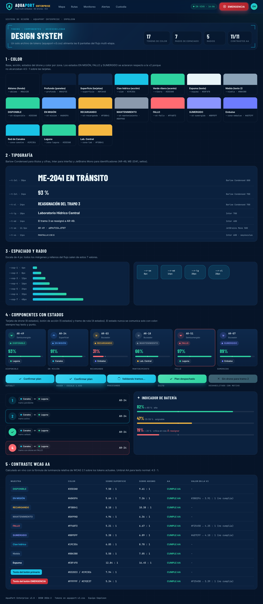
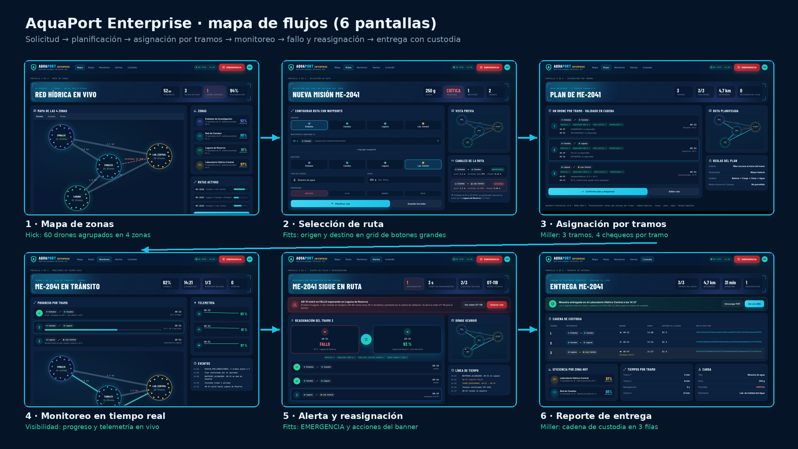

# 08 Identidad y UX: Design system completo y mapa de flujos Enterprise

**Nivel:** Empoleon · Tokens de diseño · componentes con estados · contraste WCAG AA verificado · flujo de 6 pantallas con leyes UX

## 1. Design system



Fuente: `mock/design-system.html`. Todos los valores salen de un solo archivo de tokens, `mock/aquaport-v3.css`; las 6 pantallas del flujo y el design system usan ese mismo archivo.

### Tokens

| Familia | Tokens | Uso |
|---|---|---|
| Color base | `--abismo #061428`, `--profundo #0A1F3C`, `--superficie #0F2A4D`, `--espuma #E8F4F8`, `--niebla #8BA3B8`, `--linea` | Fondo, paneles, tarjetas, texto principal y secundario |
| Color de acción | `--cian #19C3E6`, `--ribera #2ED3A0` | Solo lo que se puede pulsar o lo recomendado |
| Color de estado | `--st-disponible`, `--st-mision`, `--st-recargando`, `--st-mantenimiento`, `--st-fallo`, `--st-sumergido` | Los 6 estados del drone |
| Color por zona (nuevo) | `--zona-embalse #6D7CFF`, `--zona-canales #19C3E6`, `--zona-laguna #2ED3A0`, `--zona-lab #F5B841` | Chips de zona, mapa y tramos |
| Batería | `--bat-alta`, `--bat-media`, `--bat-baja` | ≥ 60 %, 35-59 %, < 35 % |
| Tipografía | `--t-xs 11px` a `--t-3xl 50px`; Barlow Condensed (títulos y cifras), Inter (interfaz), JetBrains Mono (IDs y sellos) | Una escala de 7 tamaños |
| Espaciado | `--esp-1 4px` a `--esp-7 48px` (escala de 4 px) | Márgenes y rellenos |
| Radio de borde | `--r-sm 8px`, `--r-md 14px`, `--r-lg 20px`, `--r-xl 28px`, `--r-pill` | Botones, tarjetas, paneles, chips |

### Componentes con estados

| Componente | Estados |
|---|---|
| Tarjeta de drone | DISPONIBLE, EN MISIÓN, RECARGANDO, MANTENIMIENTO, FALLO (borde y halo rojo), SUMERGIDO |
| Botón de acción | default, hover (escala 1.035 + sombra), procesando (spinner, bloquea doble clic), éxito, deshabilitado con motivo |
| Tramo de ruta (nuevo) | pendiente, activo, sellado, con drone en FALLO |
| Indicador de batería | alta, asignable, crítica en ruta (< 20 %, con advertencia escrita) |
| Chip de zona (nuevo) | uno por zona, siempre con nombre además del color |

## 2. Contraste WCAG AA (verificado)

La tabla del design system calcula el contraste en el navegador con la fórmula de luminancia relativa de WCAG 2.1, leyendo los tokens actuales. Al aplicarla a los colores de la v2 aparecieron **4 fallos** que se corrigieron en los tokens de la v3:

| Color | v2 | Contraste v2 sobre tarjeta | v3 | Contraste v3 | AA (≥ 4.5 : 1) |
|---|---|---|---|---|---|
| EN MISIÓN | `#3B82F6` | 3.91 : 1 | `#60A5FA` | 5.66 : 1 | Cumple |
| FALLO | `#F2545B` | 4.25 : 1 | `#FF6B72` | 5.21 : 1 | Cumple |
| SUMERGIDO | `#6D7CFF` | 4.10 : 1 | `#8B95FF` | 5.38 : 1 | Cumple |
| Texto blanco del botón EMERGENCIA | fondo `#F2545B` | 3.39 : 1 | fondo `#C92E37` | 5.34 : 1 | Cumple |

El resto de colores ya cumplía (DISPONIBLE 7.50, RECARGANDO 8.10, MANTENIMIENTO 4.96, cian 6.85, niebla 5.50, espuma 12.84, texto del botón primario 7.94). Resultado: **11 de 11** combinaciones de texto cumplen AA. Además, ningún estado se comunica solo con color: siempre hay texto en mayúsculas y punto indicador.

## 3. Mapa de flujos Enterprise (6 pantallas)



Fuente: `mock/flujo-enterprise.html?pantalla=mapa|ruta|tramos|monitoreo|alerta|reporte`. Los datos son los del código: los 60 drones de `FlotaEnterprise` con la misma fórmula de batería, el plan que calcula `PlanificadorRuta` para la misión ME-2041 (AR-15, AR-34 y AR-51), la reasignación a AR-49 que elige `ReasignadorTramo` y los sellos SHA-256 reales de `DroneConCifrado`.

## 4. Leyes UX por pantalla

| Pantalla | Ley | Cómo se aplica |
|---|---|---|
| 1 · Mapa de zonas | **Hick** | 60 drones agrupados en 4 zonas con su conteo, eficiencia y batería promedio: el operador decide primero la zona (4 opciones) y luego el drone. |
| 1 · Mapa de zonas | **Ley de proximidad (Gestalt)** | Los drones se dibujan alrededor de su zona; el canal adverso aparece sobre el canal en el mapa. |
| 2 · Selección de ruta | **Fitts** | Origen y destino se eligen en una grilla de 4 botones grandes, no en un desplegable; “Planificar ruta” ocupa 2/3 del ancho. |
| 2 · Selección de ruta | **Prevención de errores (Nielsen #5)** | El canal adverso se muestra antes de planificar, con el desvío que se va a aplicar. |
| 3 · Asignación por tramos | **Miller** | 3 tramos, 4 chequeos por tramo y máximo 2 descartes visibles por tramo. |
| 4 · Monitoreo | **Visibilidad del estado (Nielsen #1)** | Progreso del tramo activo, telemetría con tendencia y eventos con hora. |
| 5 · Alerta y reasignación | **Fitts** | EMERGENCIA fijo arriba a la derecha en todas las pantallas; las acciones del banner están junto al mensaje. |
| 5 · Alerta y reasignación | **Von Restorff (aislamiento)** | El drone en FALLO y el reemplazo se muestran grandes, uno frente al otro, separados del resto. |
| 6 · Reporte de entrega | **Miller** | La custodia se lee en 3 filas (una por tramo) con el sello completo para auditoría. |

## Archivos

```
08 Manual de Identidad y UXUI/
├── README.md
├── capturas/  design-system.png, mapa-flujos.png, flujo-*.png (6)
└── mock/      design-system.html, flujo-enterprise.html, aquaport-v3.css, aquaport-v3.js, fuentes/
```
