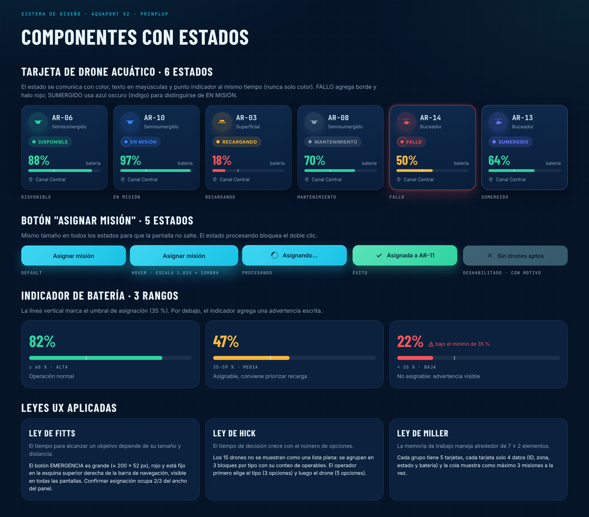
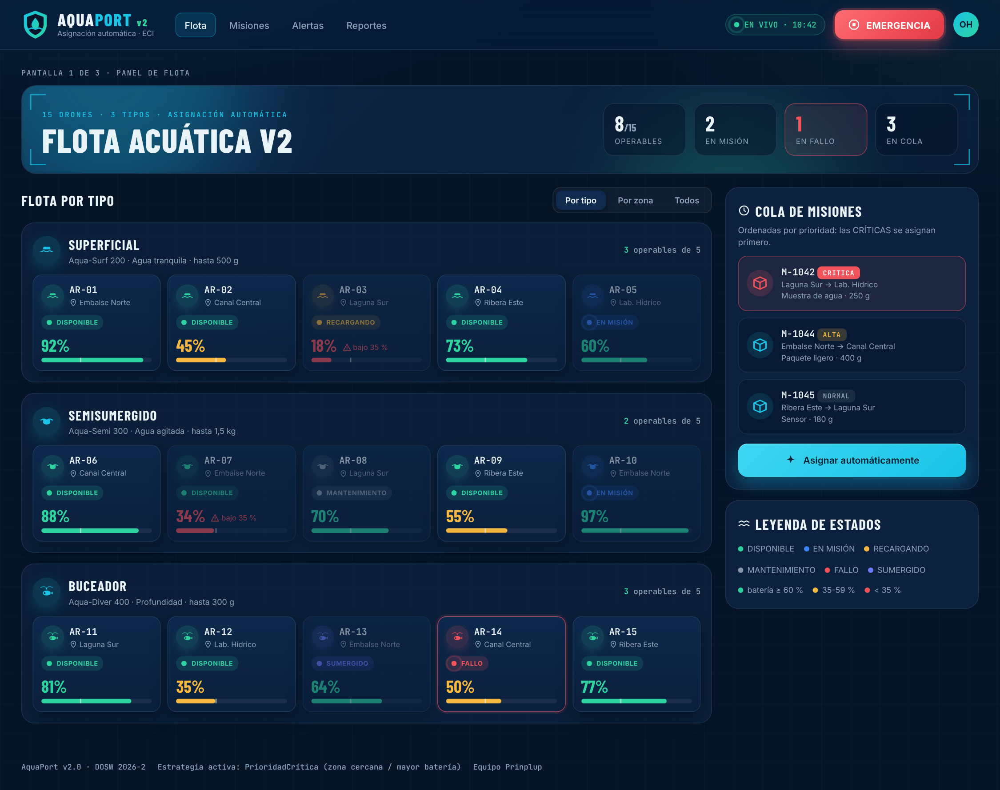
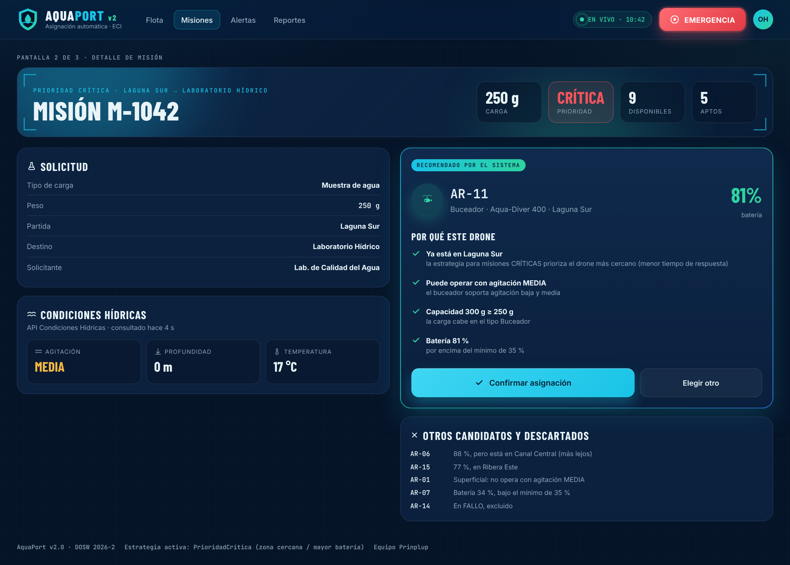
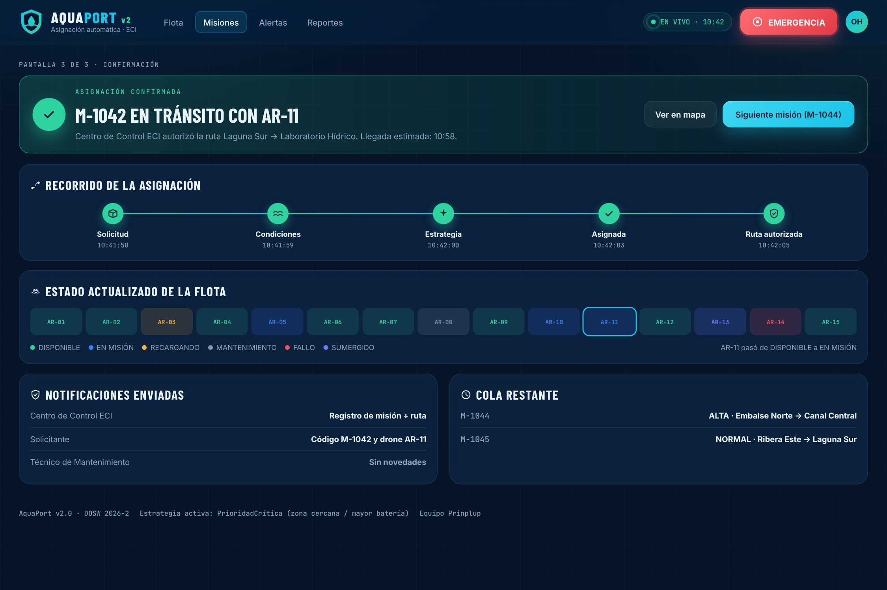

# 08 Manual de Identidad y UX/UI: Sistema de diseño de AquaPort v2

**Nivel:** Prinplup · Se parte de la identidad de Piplup (paleta, tipografía, tono) y se convierte en un **sistema de diseño con componentes y estados**, aplicando las leyes de **Fitts, Hick y Miller** a un flujo de 3 pantallas.

## 1. Qué se conserva de la identidad v1

| Elemento | Valor | Se mantiene porque |
|---|---|---|
| Fondo / paneles | Abismo `#061428`, Profundo `#0A1F3C`, Superficie `#0F2A4D` | La familia del agua sigue siendo la misma; cambiarla rompería el reconocimiento. |
| Acción primaria | Cian hídrico `#19C3E6` | Solo lo que se puede pulsar o lo seleccionado. |
| Tipografía | Barlow Condensed (títulos), Inter (interfaz), JetBrains Mono (IDs) | En la v2 hay más códigos (`AR-01` a `AR-15`, `M-1042`), la monoespaciada se vuelve más importante. |
| Tono | Dato + acción: “Batería 34 %, bajo el mínimo de 35 %” | Igual. |

## 2. Qué se agrega en la v2

| Nuevo | Valor | Por qué |
|---|---|---|
| Estado **SUMERGIDO** | Índigo `#6D7CFF` | Un drone sumergido está trabajando pero no se ve; necesitaba distinguirse del azul de EN MISIÓN. |
| Iconos por **tipo** de drone | Superficial, Semisumergido, Buceador dentro de un círculo | Con 3 tipos el operador debe reconocer el tipo antes de leer el texto. |
| **Rangos de batería** | ≥ 60 % verde · 35–59 % ámbar · < 35 % rojo con advertencia | El umbral de 35 % está en el código (`BATERIA_MINIMA_OPERACION`); la UI lo dibuja como línea vertical en cada barra. |
| Botón **EMERGENCIA** | Rojo `#F2545B` con halo, fijo en la navegación | Para misiones CRÍTICAS sin drone (punto 11, pantalla de alerta). |
| Tarjeta **Recomendado** | Borde con gradiente cian → verde | La v2 recomienda; el elemento recomendado debe resaltar sobre todo lo demás. |

Hoja de estilos compartida: `mock/aquaport-v2.css` (tokens en `:root`) y `mock/aquaport-v2.js` (iconos y datos de la flota de ejemplo, los mismos 15 drones de `FlotaEjemplo`).

## 3. Componentes con estados



Fuente: `mock/componentes.html`.

| Componente | Estados | Decisión |
|---|---|---|
| Tarjeta de drone | DISPONIBLE, EN MISIÓN, RECARGANDO, MANTENIMIENTO, FALLO, SUMERGIDO | Color + texto en mayúsculas + punto: **nunca solo color** (daltonismo). FALLO agrega borde y halo rojo. |
| Botón “Asignar misión” | default, hover (escala 1.035 + sombra), procesando, éxito, deshabilitado con motivo | Mismo tamaño en todos los estados para que la pantalla no salte. “Procesando” bloquea el doble clic. “Deshabilitado” dice por qué (“Sin drones aptos”). |
| Indicador de batería | Alta, media, baja | La línea del 35 % aparece en todas las barras; debajo del mínimo se agrega la advertencia escrita. |

## 4. Leyes UX aplicadas

| Ley | Qué dice | Dónde se aplica |
|---|---|---|
| **Fitts** | El tiempo para alcanzar un objetivo depende de su tamaño y distancia. | EMERGENCIA es grande (≈ 200 × 52 px), roja y fija arriba a la derecha en todas las pantallas. “Confirmar asignación” ocupa 2/3 del ancho del panel y “Elegir otro” el tercio restante: la acción esperada es la más fácil de alcanzar. |
| **Hick** | El tiempo de decisión crece con el número de opciones. | Los 15 drones no se muestran como una lista plana: se agrupan en 3 bloques por tipo con su conteo de operables (igual que `agruparDisponiblesPorTipo` del punto 01). El operador decide primero entre 3 tipos y luego entre 5 drones. Además el sistema ya propone uno. |
| **Miller** | La memoria de trabajo maneja alrededor de 7 ± 2 elementos. | Cada grupo tiene 5 tarjetas, cada tarjeta solo 4 datos (ID, zona, estado, batería) y la cola muestra como máximo 3 misiones a la vez. |

## 5. Flujo de 3 pantallas

Fuente: `mock/flujo-asignacion.html?pantalla=flota|detalle|confirmacion` (el mismo archivo del punto 11).

| 1. Flota agrupada por tipo | 2. Detalle de la misión M-1042 | 3. Confirmación |
|---|---|---|
|  |  |  |
| KPIs, cola de misiones por prioridad, 3 grupos por tipo. | Solicitud, condiciones hídricas, drone recomendado (AR-11) con **por qué este drone** y los descartados con su motivo. | Recorrido de la asignación en 5 pasos, flota actualizada (AR-11 pasa a EN MISIÓN), notificaciones enviadas y cola restante. |

La pantalla 2 muestra la decisión de `PrioridadCriticaStrategy`: la misión es CRÍTICA, así que se prefiere AR-11 (81 %, ya en Laguna Sur) sobre AR-06 (88 %, en Canal Central). Los descartados explican cada regla de `ValidadorAsignacion`: superficial con agitación MEDIA, AR-07 con 34 %, AR-14 en FALLO.

## Archivos

```
08 Manual de Identidad y UXUI/
├── README.md
├── capturas/  componentes.png, flujo-flota.png, flujo-detalle.png, flujo-confirmacion.png
└── mock/      componentes.html, flujo-asignacion.html, aquaport-v2.css, aquaport-v2.js, fuentes/
```
