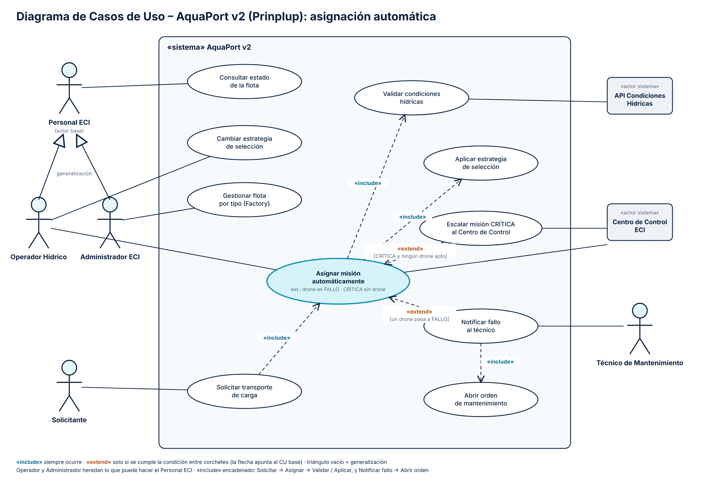

# 10 Diagramas de Casos de Uso: AP-07 “Asignar misión automáticamente”

**Nivel:** Prinplup · Se agregan **generalización de actores**, **«include» encadenados** y **«extend» con condición**.

Archivos: `docs/diagrama-cu-prinplup.png` (entregable) y `docs/diagrama-cu-prinplup.svg` (fuente vectorial).

## Actores

| Actor | Tipo | Casos de uso |
|---|---|---|
| **Personal ECI** | Actor base (abstracto) | Consultar estado de la flota |
| **Operador Hídrico** | Hereda de Personal ECI | Además: Cambiar estrategia de selección, supervisa Asignar misión automáticamente |
| **Administrador ECI** | Hereda de Personal ECI | Además: Gestionar flota por tipo (Factory) |
| **Solicitante** | Persona | Solicitar transporte de carga |
| **Técnico de Mantenimiento** | Persona (nuevo en v2) | Notificar fallo al técnico |
| **API Condiciones Hídricas** | «actor sistema» | Validar condiciones hídricas |
| **Centro de Control ECI** | «actor sistema» | Asignar misión automáticamente (registro), Escalar misión CRÍTICA |

**Generalización:** Operador y Administrador comparten “Consultar estado de la flota”. En vez de dibujar dos líneas al mismo caso de uso, ambos heredan de *Personal ECI* (triángulo vacío). Si mañana entra otro rol del personal, hereda lo común sin redibujar.

## «include» (siempre ocurre)

| CU base | «include» | Por qué es include |
|---|---|---|
| Solicitar transporte de carga | Asignar misión automáticamente | En la v2 toda solicitud dispara la asignación; no hay paso manual. |
| Asignar misión automáticamente | Validar condiciones hídricas | Nunca se asigna sin conocer el agua del destino (AP-10). |
| Asignar misión automáticamente | Aplicar estrategia de selección | La elección siempre la hace la estrategia activa (Strategy). |
| Notificar fallo al técnico | Abrir orden de mantenimiento | Cada notificación de fallo genera su orden. |

Las relaciones forman una cadena: **Solicitar → Asignar → Validar / Aplicar**, y **Notificar fallo → Abrir orden**.

## «extend» (solo con condición)

| CU que extiende | → CU base | Condición |
|---|---|---|
| Notificar fallo al técnico | Asignar misión automáticamente | `[un drone pasa a FALLO]` |
| Escalar misión CRÍTICA al Centro de Control | Asignar misión automáticamente | `[CRÍTICA y ningún drone apto]` |

La flecha de «extend» apunta al caso base, porque es el caso extendido el que sabe cuándo se agrega. La asignación funciona igual si nunca hay fallos ni misiones críticas sin drone.

## Correspondencia con el código

| Caso de uso | Clase |
|---|---|
| Asignar misión automáticamente | `AsignadorAutomatico.asignar` / `asignarPorPrioridad` |
| Validar condiciones hídricas | `ProveedorCondicionesHidricas` + `ValidadorAsignacion` |
| Aplicar estrategia de selección | `EstrategiaSeleccion` y sus implementaciones |
| Cambiar estrategia de selección | Se inyecta otra estrategia en el constructor del asignador |
| Notificar fallo al técnico / Abrir orden | `EventoMision.droneEnFallo` → `TecnicoMantenimientoObserver` |
| Escalar misión CRÍTICA | `EventoMision.sinDrone` → `CentroControlObserver` (“ALERTA CRÍTICA”) |
| Gestionar flota por tipo | `FabricaDrones` |
| Consultar estado de la flota | `ConsultorFlota` |

## Decisiones

- **Ningún caso de uso es un paso de interfaz** (“hacer clic”, “abrir pantalla”): todos son objetivos del actor.
- **Los sistemas externos van como actores con estereotipo «actor sistema»** y en el lado derecho, para separarlos de las personas.
- **Las condiciones de los extend van en la etiqueta**, no en una nota aparte, para que se lean junto a la flecha.
