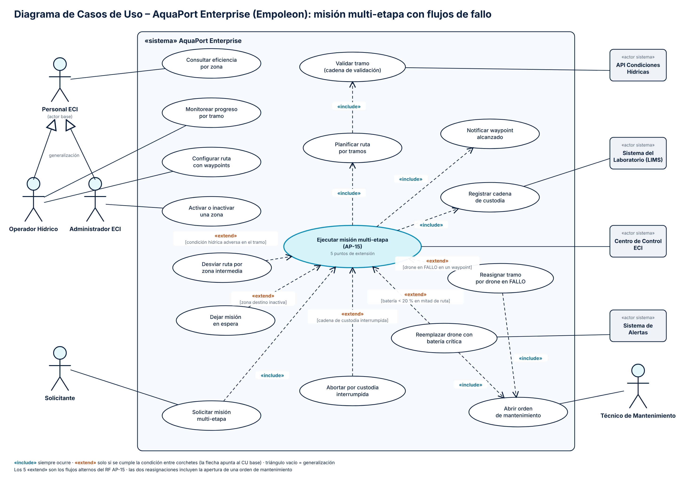

# 10 Diagramas de Casos de Uso: AP-15 con todos los flujos de fallo

**Nivel:** Empoleon · 5 «extend» con condición explícita · «include» encadenados · generalización de actores · 4 actores sistema

Archivos: `docs/diagrama-cu-empoleon.png` (entregable) y `docs/diagrama-cu-empoleon.svg` (fuente vectorial).

## Actores

| Actor | Tipo | Casos de uso |
|---|---|---|
| Personal ECI | Actor base | Consultar eficiencia por zona |
| Operador Hídrico | Hereda de Personal ECI | Monitorear progreso por tramo, Configurar ruta con waypoints |
| Administrador ECI | Hereda de Personal ECI | Activar o inactivar una zona |
| Solicitante | Persona | Solicitar misión multi-etapa |
| Técnico de Mantenimiento | Persona | Abrir orden de mantenimiento |
| API Condiciones Hídricas | «actor sistema» | Validar tramo |
| Centro de Control ECI | «actor sistema» | Ejecutar misión multi-etapa (registro y autorización) |
| Sistema del Laboratorio (LIMS) | «actor sistema» | Registrar cadena de custodia |
| Sistema de Alertas | «actor sistema» | Reemplazar drone con batería crítica |

## Caso base: Ejecutar misión multi-etapa (AP-15)

### «include» (siempre ocurren)

| CU base | «include» | Por qué |
|---|---|---|
| Solicitar misión multi-etapa | Ejecutar misión multi-etapa | Toda solicitud válida se ejecuta. |
| Ejecutar misión multi-etapa | Planificar ruta por tramos | No se recorre nada sin un drone por tramo. |
| Planificar ruta por tramos | Validar tramo (cadena de validación) | Cada candidato pasa por batería, capacidad, zona activa y condiciones. |
| Ejecutar misión multi-etapa | Registrar cadena de custodia | Cada tramo deja un registro sellado (RN-04). |
| Ejecutar misión multi-etapa | Notificar waypoint alcanzado | Cada llegada se publica a los observadores. |
| Reasignar tramo por drone en FALLO | Abrir orden de mantenimiento | El drone retirado siempre genera una orden. |
| Reemplazar drone con batería crítica | Abrir orden de mantenimiento | Igual que la anterior. |

### «extend» (los 5 flujos alternos de Empoleon)

| CU que extiende | Condición | Flujo alterno del RF AP-15 |
|---|---|---|
| Reasignar tramo por drone en FALLO | `[drone en FALLO en un waypoint]` | FA-01 |
| Desviar ruta por zona intermedia | `[condición hídrica adversa en el tramo]` | FA-02 |
| Dejar misión en espera | `[zona destino inactiva]` | FA-03 |
| Reemplazar drone con batería crítica | `[batería < 20 % en mitad de ruta]` | FA-04 |
| Abortar por custodia interrumpida | `[cadena de custodia interrumpida]` | FA-05 |

Todas las flechas «extend» apuntan al caso base y llevan su condición en la etiqueta. El caso base funciona completo sin ninguna extensión (la ruta normal), que es justo lo que distingue un «extend» de un «include».

## Correspondencia con el código

| Caso de uso | Clase |
|---|---|
| Ejecutar misión multi-etapa | `ServicioMisionMultiEtapa.ejecutar` |
| Planificar ruta por tramos | `PlanificadorRuta.planificar` |
| Validar tramo | `CadenaValidacion.enterprise` y los 4 `Validador*` |
| Registrar cadena de custodia | `CadenaCustodia.registrar` + `DroneConCifrado` |
| Notificar waypoint alcanzado | `PublicadorEventosRuta` → `ObservadorRuta` |
| Reasignar tramo / Reemplazar drone | `ReasignadorTramo.droneListo` |
| Desviar ruta | `DesviadorRuta.tramosSeguros` |
| Dejar misión en espera | `ServicioMisionMultiEtapa` (zona destino inactiva) |
| Abortar por custodia interrumpida | `EjecutorRuta` al capturar `CustodiaInterrumpidaException` |
| Abrir orden de mantenimiento | `TecnicoMantenimientoObservador` |
| Consultar eficiencia por zona | `ConsultorRed.eficienciaPorZona` |

## Decisiones

- **Dos casos distintos para FALLO y batería crítica** aunque los dos terminan en una reasignación: la condición, el evento publicado (`TRAMO_REASIGNADO` frente a `BATERIA_CRITICA_EN_RUTA`) y el actor que se entera (técnico frente a Sistema de Alertas) son distintos.
- **“Validar tramo” lo incluye la planificación, no la ejecución**: la validación ocurre al elegir el drone, y una reasignación vuelve a planificar ese tramo.
- **Generalización**: Operador y Administrador heredan “Consultar eficiencia por zona” de Personal ECI en lugar de tener dos líneas al mismo caso.
