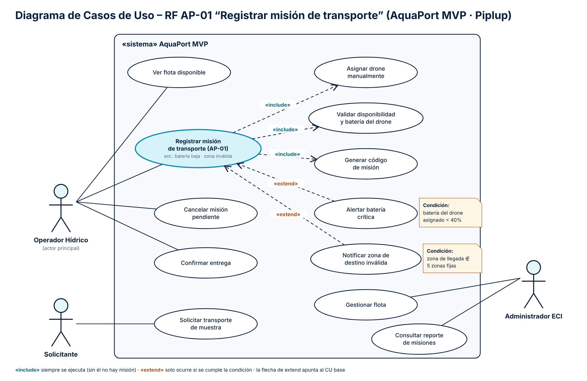

# 10 Diagramas de Casos de Uso: RF AP-01 “Registrar misión de transporte”

**Nivel:** Piplup

Archivos: `docs/diagrama-cu-piplup.png` (entregable) y `docs/diagrama-cu-piplup.svg` (fuente vectorial).

## Elementos

| Elemento | En el diagrama |
|---|---|
| **Sistema** | Rectángulo «sistema» AquaPort MVP: todos los casos de uso quedan dentro. |
| **Actores** | Operador Hídrico (actor principal de AP-01), Solicitante, Administrador ECI, fuera del sistema. |
| **CU base** | *Registrar misión de transporte (AP-01)*, resaltado y con sus puntos de extensión. |
| **Otros CU** | Ver flota disponible, Cancelar misión pendiente, Confirmar entrega, Solicitar transporte de muestra, Gestionar flota, Consultar reporte de misiones. |

## Relaciones «include» (siempre ocurren)

| CU base | «include» | Por qué es include |
|---|---|---|
| Registrar misión | Asignar drone manualmente | En el MVP no existe misión sin drone asignado por el operador. |
| Registrar misión | Validar disponibilidad y batería del drone | Sin validación no se puede crear la misión (regla de seguridad). |
| Registrar misión | Generar código de misión | Toda misión registrada recibe su código `M-NNN`. |

## Relaciones «extend» (solo bajo una condición)

| CU que extiende | → CU base | Condición |
|---|---|---|
| Alertar batería crítica | Registrar misión | La batería del drone asignado es **< 40 %** (está entre 35 % y 39 %: se permite asignar, pero se alerta). |
| Notificar zona de destino inválida | Registrar misión | La zona de llegada **no pertenece** a las 5 zonas fijas. |

## Prueba rápida include vs. extend

> *¿Puede el CU base funcionar sin esto?*
> - ¿Registrar misión sin validar el drone? **No** → `«include»`.
> - ¿Registrar misión sin alertar batería crítica? **Sí**, en la mayoría de los casos no hay alerta → `«extend»`.

## Notación

- Asociación actor–CU: línea continua sin flecha.
- `«include»`: línea punteada **desde el CU base hacia el incluido**.
- `«extend»`: línea punteada **desde el CU que extiende hacia el CU base**; la condición va en una nota y los puntos de extensión se listan en el CU base.
