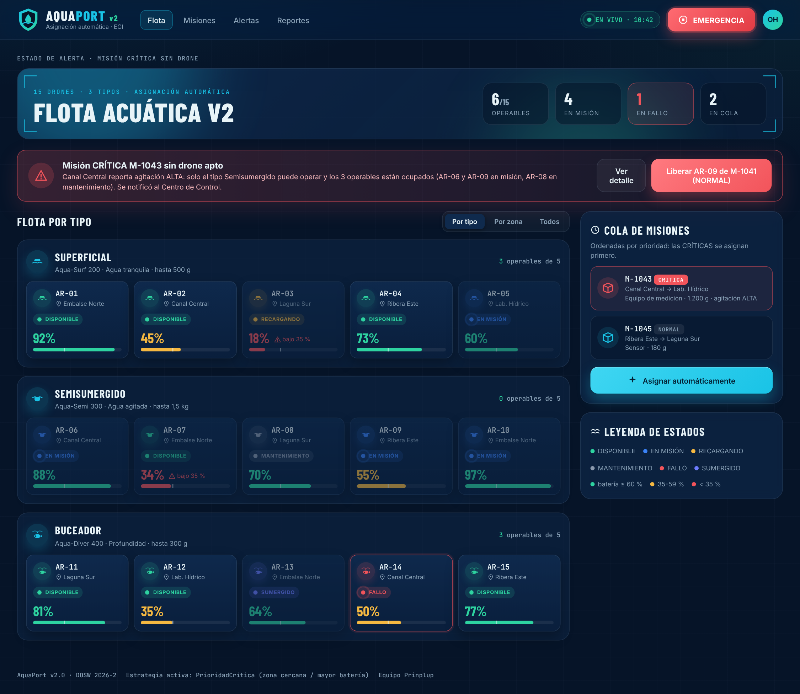

# 11 Mocks con IA: Flujo de asignación automática en 3 pantallas + alerta

**Nivel:** Prinplup · Mismo proceso de 4 pasos de Piplup, ahora con **un prompt por pantalla** y un flujo completo (no una sola vista).

## Paso 1 · Referencias

Se reutilizan las referencias del punto 11 de Piplup (Airdata, panel de flota de drones, y Hydroviewer, monitoreo hídrico) y se agrega lo que la v2 necesitaba de ellas:

| Referencia | Qué se tomó para la v2 |
|---|---|
| Panel de flota de drones (Airdata) | Agrupar unidades por modelo/tipo con conteo de operables; tarjeta compacta por unidad. |
| Monitoreo hídrico (Hydroviewer) | Indicadores de condiciones del agua por punto (agitación, profundidad, temperatura) junto a la decisión. |
| Sistemas de despacho (patrón general) | Recomendación con **razones visibles** y lista de candidatos descartados, para que la decisión automática sea auditable. |


## Paso 2 · Estilo

El sistema de diseño del **punto 08**: tokens de `aquaport-v2.css`, colores de estado (incluido SUMERGIDO índigo), rangos de batería y botón EMERGENCIA.

## Paso 3 · Datos del RF AP-07

| Qué necesita el operador | Pantalla |
|---|---|
| Ver la flota de 15 drones sin perderse | 1. Flota agrupada por tipo |
| Entender por qué el sistema eligió un drone | 2. Detalle de misión con “por qué este drone” |
| Confirmar que la asignación ocurrió y qué cambió | 3. Confirmación con línea de tiempo |
| Saber qué hacer cuando no hay drone para una CRÍTICA | Alerta |

## Paso 4 · Prompts (uno por pantalla)

Todos empiezan con el mismo bloque de contexto para que las pantallas sean consistentes:

```text
CONTEXTO COMÚN
Actúa como diseñador UX/UI senior de sistemas de despacho y monitoreo ambiental.
SISTEMA: AquaPort v2, asignación automática de drones acuáticos de la ECI.
ESTILO: fondo #061428, paneles #0A1F3C, tarjetas #0F2A4D, acción #19C3E6,
  acento #2ED3A0, texto #E8F4F8, secundario #8BA3B8. Barlow Condensed para
  títulos, Inter para interfaz, JetBrains Mono para IDs (AR-01, M-1042).
  Paneles con efecto vidrio, íconos vectoriales en círculos, sin emojis.
ESTADOS: DISPONIBLE #2ED3A0 · EN_MISION #3B82F6 · RECARGANDO #F5B841 ·
  MANTENIMIENTO #8A99AD · FALLO #F2545B · SUMERGIDO #6D7CFF. Siempre color + texto.
BATERÍA: ≥60 % verde, 35-59 % ámbar, <35 % rojo con "bajo 35 %". Línea del 35 % en la barra.
NAVEGACIÓN: Flota, Misiones, Alertas, Reportes; indicador EN VIVO; botón EMERGENCIA
  rojo, grande y fijo arriba a la derecha (ley de Fitts).
```

### Prompt pantalla 1: Flota

```text
PANTALLA: Panel de flota (1 de 3).
ACTOR: Operador Hídrico que supervisa la asignación automática.
DATOS: 15 drones en 3 grupos por tipo (Superficial, Semisumergido, Buceador),
  5 por grupo, cada tarjeta con ID, zona, estado y batería (solo esos 4 datos).
  Encabezado de cada grupo: modelo, condición en la que opera, carga máxima y
  "N operables de 5". KPIs: operables, en misión, en fallo, en cola.
  Columna derecha: cola de misiones ordenada por prioridad (máximo 3 visibles)
  y botón "Asignar automáticamente".
LEYES: Hick (decidir primero el tipo, luego el drone), Miller (máx. 5 tarjetas
  por grupo y 3 misiones en cola).
NIELSEN: #1 visibilidad del estado, #4 consistencia, #8 minimalismo.
```

### Prompt pantalla 2: Detalle de misión

```text
PANTALLA: Detalle de la misión M-1042 (2 de 3).
DATOS: misión CRÍTICA, Laguna Sur → Laboratorio Hídrico, muestra de agua 250 g.
  Condiciones hídricas consultadas a la API: agitación MEDIA, 0 m, 17 °C.
  Drone recomendado AR-11 (Buceador, 81 %, ya en Laguna Sur) con la lista
  "Por qué este drone": cercanía (estrategia para CRÍTICAS), puede operar con
  agitación MEDIA, capacidad 300 g ≥ 250 g, batería sobre el 35 %.
  Otros candidatos y descartados con el motivo de cada uno.
ACCIONES: "Confirmar asignación" (2/3 del ancho) y "Elegir otro".
NIELSEN: #1 visibilidad, #6 reconocer antes que recordar, #3 control del usuario.
```

### Prompt pantalla 3: Confirmación

```text
PANTALLA: Confirmación de asignación (3 de 3).
DATOS: banner de éxito "M-1042 en tránsito con AR-11" con la ruta autorizada por
  el Centro de Control y la hora estimada de llegada. Recorrido de la asignación
  en 5 pasos con hora (solicitud, condiciones, estrategia, asignada, ruta
  autorizada). Flota de 15 drones en miniatura donde AR-11 ya aparece EN MISIÓN.
  Notificaciones enviadas (Centro de Control, Solicitante, Técnico) y cola restante.
ACCIONES: "Ver en mapa" y "Siguiente misión (M-1044)".
NIELSEN: #1 visibilidad del estado, #4 consistencia (mismos colores de estado).
```

### Prompt pantalla de alerta

```text
PANTALLA: Estado de alerta del panel de flota.
DATOS: misión CRÍTICA M-1043 (Canal Central → Lab. Hídrico, equipo de medición
  1.200 g) sin drone apto. Canal Central reporta agitación ALTA: solo el tipo
  Semisumergido puede operar y sus 3 operables están ocupados (AR-06 y AR-09 en
  misión, AR-08 en mantenimiento). Se notificó al Centro de Control.
  Banner rojo arriba de todo con la causa en una frase y dos acciones:
  "Ver detalle" y "Liberar AR-09 de M-1041 (NORMAL)".
NIELSEN: #9 mensajes de error que explican la causa y proponen solución,
  #1 visibilidad del estado, #5 prevención de errores.
```

## Resultado

Archivo único `mock/flujo-asignacion.html`; la pantalla se elige con `?pantalla=flota|detalle|confirmacion|alerta`.

| Pantalla | Captura |
|---|---|
| 1. Flota agrupada por tipo |  |
| 2. Detalle de la misión M-1042 |  |
| 3. Confirmación |  |
| Alerta: CRÍTICA sin drone |  |

Los datos son los de `FlotaEjemplo` (los mismos 15 drones de las pruebas) y las decisiones mostradas son las que toma el código: en la pantalla 2 gana AR-11 por `ZonaCercanaStrategy` aunque AR-06 tiene más batería; en la alerta el banner corresponde al evento `MISION_SIN_DRONE` de una misión CRÍTICA.

## Verificación con Nielsen

| # | Heurística | Dónde |
|---|---|---|
| 1 | Visibilidad del estado | KPIs, EN VIVO, estado y batería en cada tarjeta, recorrido de la asignación y notificaciones enviadas en la confirmación. |
| 2 | Relación con el mundo real | Zonas del campus, tipos de drone con su condición de operación (“agua agitada”, “profundidad”). |
| 3 | Control y libertad | “Elegir otro” en el detalle: el operador puede no aceptar la recomendación. |
| 4 | Consistencia | Misma tarjeta, mismos colores y misma navegación en las 4 vistas. |
| 5 | Prevención de errores | Drones bajo 35 % atenuados con “bajo 35 %”; descartados con su motivo. |
| 6 | Reconocer antes que recordar | El sistema muestra el recomendado y la razón; el operador no recuerda reglas. |
| 8 | Minimalismo | 4 datos por tarjeta, máximo 3 misiones en cola. |
| 9 | Ayuda a reconocer y recuperarse de errores | La alerta dice la causa (agitación ALTA, semisumergidos ocupados) y propone liberar AR-09. |

No se cubren en este mock: #7 (atajos para expertos) y #10 (ayuda y documentación).
