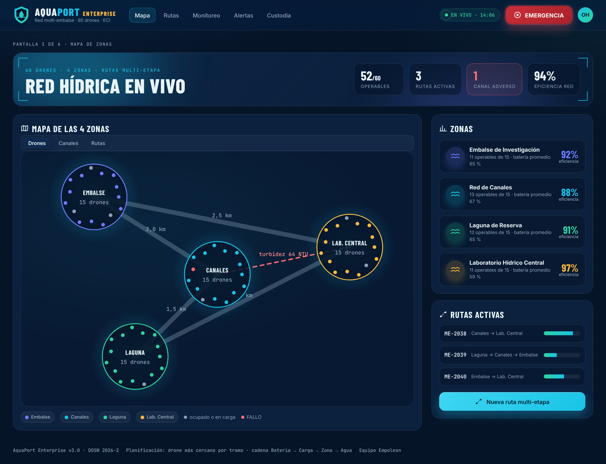
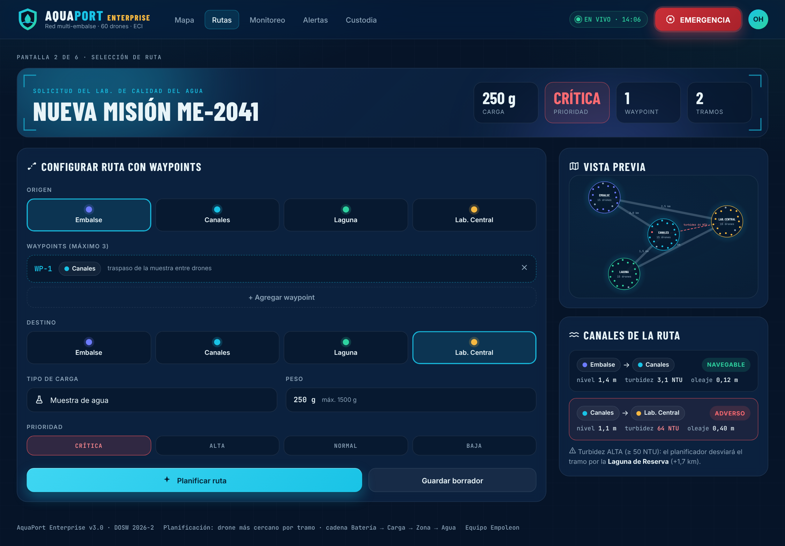
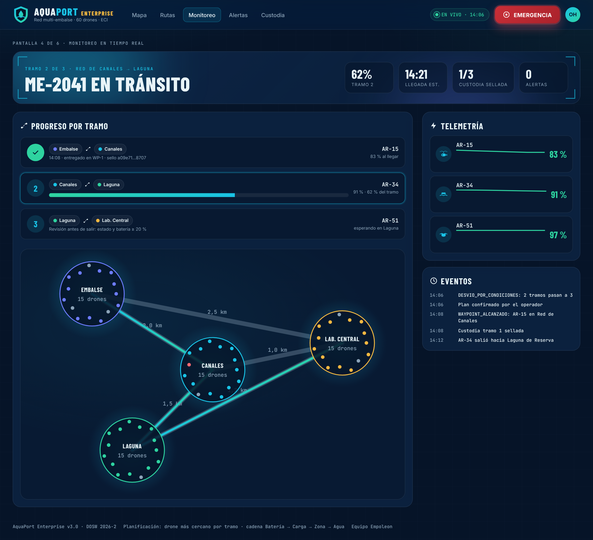
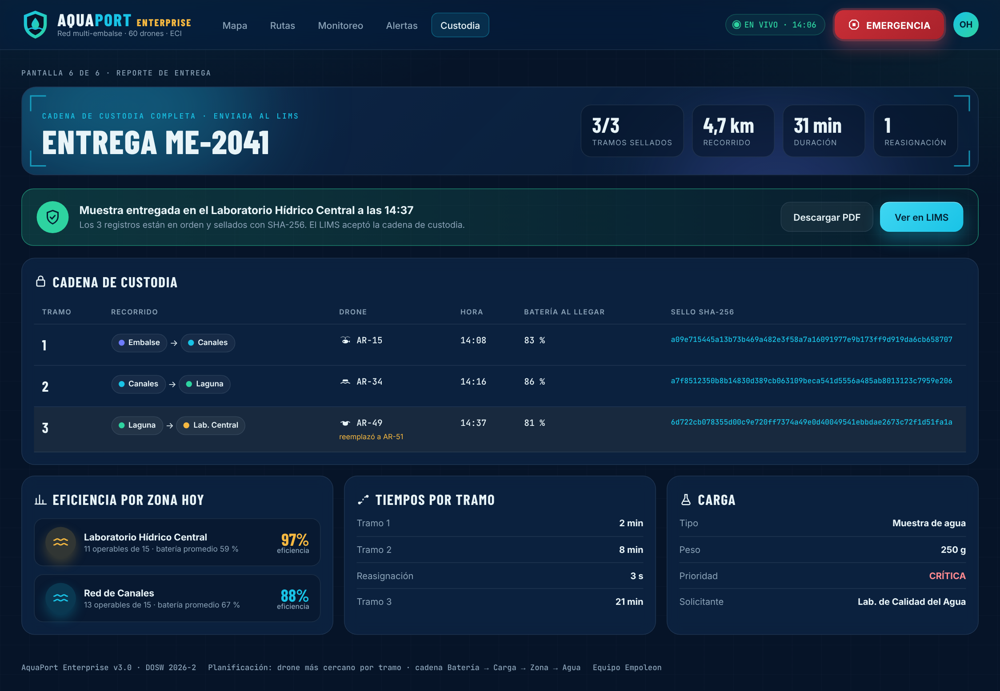

# 11 Mocks con IA: Mapa de zonas y monitoreo de rutas multi-etapa

**Nivel:** Empoleon · 5 pantallas con datos reales del dominio · 5 prompts · mismo proceso de 4 pasos (referencias, estilo, datos del RF, prompt)

## Paso 1 · Referencias

Se mantienen las referencias de los niveles anteriores (Airdata para la flota y Hydroviewer para el monitoreo hídrico) y se agregan los patrones que el Enterprise necesitaba:

| Patrón de referencia | Qué se tomó |
|---|---|
| Paneles de seguimiento de envíos con varias escalas | Progreso tramo a tramo con estado por escala y hora de llegada |
| Mapas de redes de distribución (nodos y conexiones) | Zonas como nodos, canales como conexiones con distancia y estado |
| Reportes de cadena de custodia de laboratorios | Tabla por traspaso con responsable, hora y firma (aquí, el sello SHA-256) |


## Paso 2 · Estilo

El design system del **punto 08** (`aquaport-v3.css`): tokens con contraste AA, color por zona y los nuevos componentes de tramo y chip de zona.

## Paso 3 · Datos del RF AP-15

La misión de ejemplo es la que el código resuelve de verdad con la flota de 60 drones:

| Dato | Valor (calculado por el código) |
|---|---|
| Misión | ME-2041 · Embalse → WP-1 Red de Canales → Lab. Central · muestra de agua 250 g · CRÍTICA |
| Desvío | Canal Canales → Lab con turbidez 64 NTU: la ruta pasa por la Laguna (2 tramos → 3) |
| Plan | Tramo 1 AR-15 (buceador, 95 %) · tramo 2 AR-34 (superficial, 98 %) · tramo 3 AR-51 (semisumergido, 97 %) |
| Fallo | AR-51 en FALLO en el waypoint de la Laguna → reemplazo AR-49 (93 %, misma zona) |
| Sellos | `a09e7154…8707`, `a7f85123…e206`, `6d722cb0…fa1a` (SHA-256 reales de `DroneConCifrado`) |

## Paso 4 · Prompts (uno por pantalla)

Bloque de contexto común a los 5 prompts:

```text
CONTEXTO COMÚN
Actúa como diseñador UX/UI senior de sistemas de despacho y monitoreo ambiental.
SISTEMA: AquaPort Enterprise, red de 60 drones acuáticos en 4 zonas hídricas de la ECI.
ZONAS (color): Embalse de Investigación #6D7CFF, Red de Canales #19C3E6,
  Laguna de Reserva #2ED3A0, Laboratorio Hídrico Central #F5B841.
ESTILO: tokens de aquaport-v3.css. Fondo #061428, paneles #0A1F3C, tarjetas #0F2A4D,
  acción #19C3E6, texto #E8F4F8. Estados con contraste AA: DISPONIBLE #2ED3A0,
  EN MISIÓN #60A5FA, RECARGANDO #F5B841, MANTENIMIENTO #8A99AD, FALLO #FF6B72,
  SUMERGIDO #8B95FF. Barlow Condensed para títulos, Inter para interfaz, JetBrains Mono
  para IDs (AR-XX, ME-XXXX, WP-N) y sellos. Paneles con efecto vidrio, íconos propios
  en círculos, sin emojis. Botón EMERGENCIA #C92E37 fijo arriba a la derecha.
DATOS: usar siempre IDs, zonas y tipos de carga reales del dominio.
```

### Prompt 1 · Mapa de las 4 zonas

```text
PANTALLA: Mapa de la red hídrica en tiempo real.
DATOS: 4 zonas como nodos con sus 15 drones alrededor (punto de color por estado);
  5 canales con distancia (Embalse–Canales 2,0 km, Embalse–Lab 2,5 km, Canales–Laguna
  1,5 km, Canales–Lab 1,0 km, Laguna–Lab 1,2 km). El canal Canales–Lab está ADVERSO
  (turbidez 64 NTU): dibujarlo punteado en rojo con el valor.
  Panel lateral por zona: operables de 15, batería promedio y eficiencia de entregas.
  Rutas activas ME-2038, ME-2039, ME-2040 con barra de progreso.
LEYES: Hick (agrupar 60 drones en 4 zonas), proximidad.
```

### Prompt 2 · Configuración de ruta con waypoints

```text
PANTALLA: Nueva misión ME-2041.
DATOS: origen y destino como grilla de 4 botones de zona (no desplegable);
  waypoint WP-1 en Red de Canales con opción de agregar hasta 3; carga muestra de agua
  250 g; prioridad CRÍTICA en chips. Panel de canales de la ruta con nivel, turbidez y
  oleaje por canal; el canal adverso advierte el desvío por la Laguna (+1,7 km).
ACCIONES: "Planificar ruta" (2/3 del ancho) y "Guardar borrador".
NIELSEN: prevención de errores (#5), reconocer antes que recordar (#6).
```

### Prompt 3 · Monitoreo de progreso por tramo

```text
PANTALLA: ME-2041 en tránsito, tramo 2 de 3.
DATOS: lista de tramos con estado (sellado, activo con barra de 62 %, pendiente);
  tramo 1 AR-15 sellado con "a09e71…8707"; tramo 2 AR-34; tramo 3 AR-51 esperando.
  Panel de telemetría con mini gráfico de batería por drone (AR-15 83 %, AR-34 91 %,
  AR-51 97 %). Registro de eventos con hora (DESVIO_POR_CONDICIONES, WAYPOINT_ALCANZADO).
NIELSEN: visibilidad del estado del sistema (#1).
```

### Prompt 4 · Alerta de fallo con reasignación automática

```text
PANTALLA: Alerta. AR-51 entró en FALLO esperando en el waypoint de la Laguna.
DATOS: banner rojo con causa y consecuencia en una frase; tarjeta AR-51 (FALLO) frente
  a tarjeta AR-49 (93 %, misma zona) con una flecha de intercambio grande en el centro;
  chequeos de la cadena aprobados para AR-49; orden técnica OT-118; tramos 1 y 2
  sellados y el 3 ahora con AR-49; línea de tiempo de la reasignación (3 s).
ACCIONES: "Ver orden OT-118" y "Detener ruta" junto al mensaje.
NIELSEN: #9 ayudar a reconocer y recuperarse de errores; Von Restorff para el cambio.
```

### Prompt 5 · Reporte final de la cadena de custodia

```text
PANTALLA: Entrega ME-2041 en el Laboratorio Hídrico Central a las 14:37.
DATOS: tabla de custodia con 3 filas: tramo, recorrido con chips de zona, drone con
  ícono de tipo, hora, batería al llegar y sello SHA-256 completo. La fila 3 marca que
  AR-49 reemplazó a AR-51. Resumen: 3/3 tramos sellados, 4,7 km, 31 min, 1 reasignación.
  Panel de eficiencia por zona, tiempos por tramo y datos de la carga.
ACCIONES: "Ver en LIMS" y "Descargar PDF".
LEYES: Miller (una fila por tramo).
```

## Resultado

Archivo único `mock/flujo-enterprise.html?pantalla=mapa|ruta|monitoreo|alerta|reporte` (la sexta pantalla, `tramos`, se usa en el punto 08).

| Pantalla | Captura |
|---|---|
| 1 · Mapa de las 4 zonas |  |
| 2 · Configuración de ruta |  |
| 3 · Monitoreo por tramo |  |
| 4 · Alerta y reasignación |  |
| 5 · Reporte de custodia |  |

## Verificación con Nielsen

| # | Heurística | Dónde |
|---|---|---|
| 1 | Visibilidad del estado | Progreso por tramo, telemetría en vivo, EN VIVO con hora, eventos con hora. |
| 2 | Relación con el mundo real | Zonas, waypoints, canales y cadena de custodia con el vocabulario del laboratorio. |
| 3 | Control y libertad | “Guardar borrador”, “Editar ruta”, “Detener ruta”. |
| 4 | Consistencia | Mismo chip de zona, mismo tramo y mismos colores de estado en las 5 pantallas. |
| 5 | Prevención de errores | El canal adverso se ve antes de planificar; drones bajo 35 % aparecen como descartados con motivo. |
| 6 | Reconocer antes que recordar | El plan muestra por qué se eligió cada drone y quién quedó como reemplazo. |
| 8 | Minimalismo | 4 datos por drone, una fila por tramo. |
| 9 | Recuperarse de errores | La alerta explica qué pasó, qué hizo el sistema (reasignó) y qué puede hacer el operador. |
