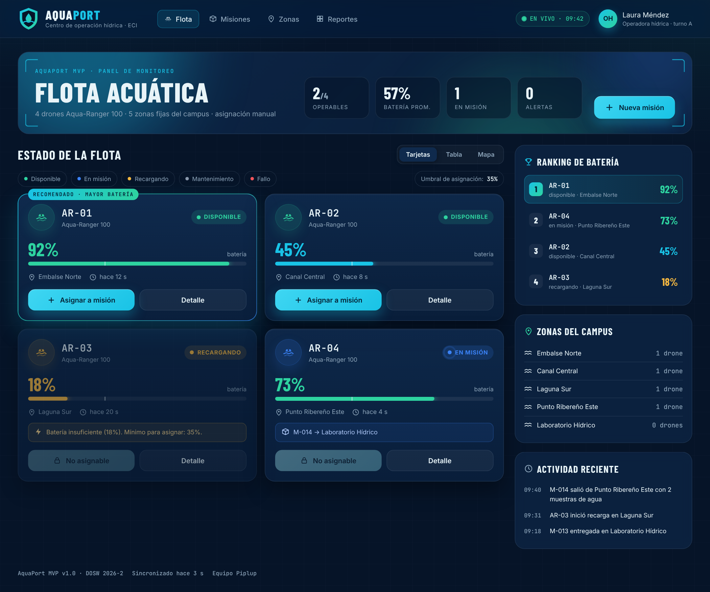
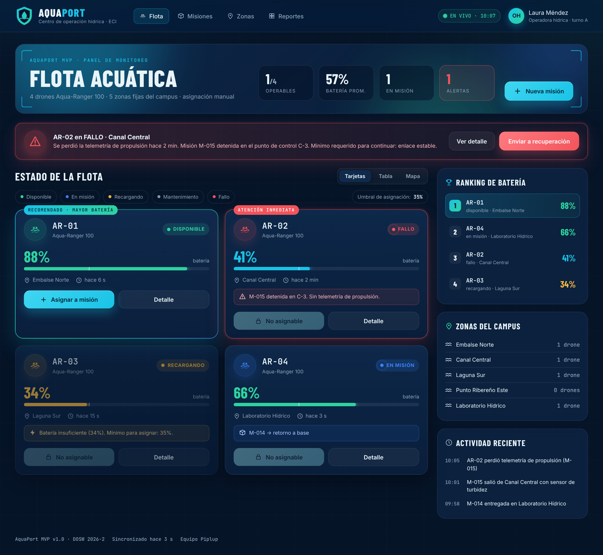
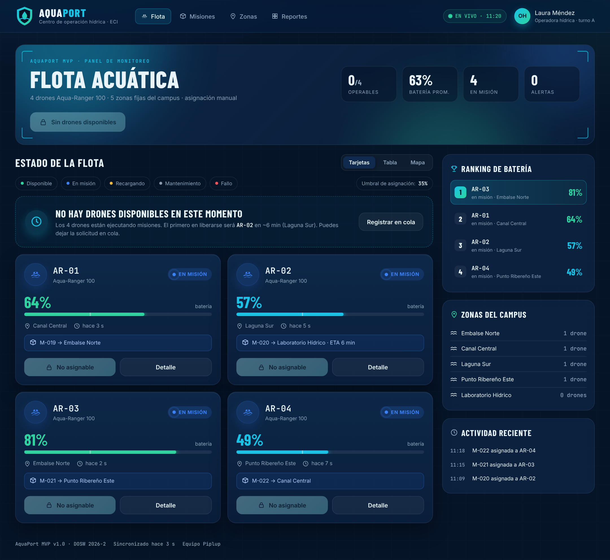
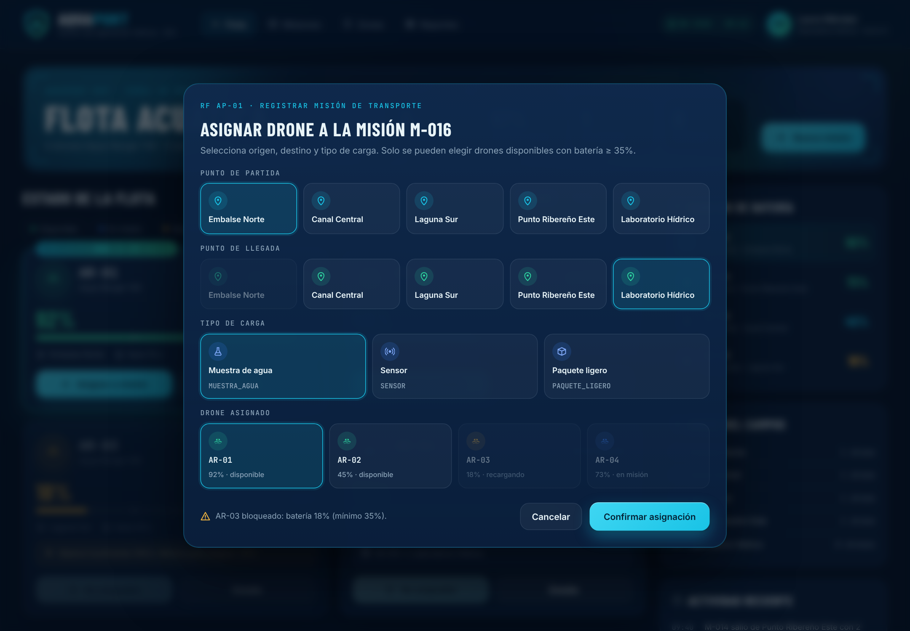

# 11 Mocks con IA: Panel del operador con el proceso de 4 pasos

**Nivel:** Piplup

## Paso 1 · Referencias

Se tomaron como referencia (solo para estudiar la pantalla de monitoreo, no para copiarla) dos tipos de sistema real:

1. **Paneles de control de flotas de vehículos autónomos/drones** (vista de flota con tarjeta por unidad, batería, estado y ubicación).
2. **Tableros de monitoreo hídrico de centros de control ambiental** (indicadores en vivo por cuerpo de agua, alertas destacadas en rojo y registro cronológico de eventos).

**Pendiente:** agregar en `referencias/` las dos capturas de pantalla de las referencias concretas que consultaron (el reto pide capturarlas).

Patrones tomados de las referencias: tarjeta por unidad con estado + batería, banner de alerta arriba de todo, KPIs resumidos en la cabecera y registro de actividad lateral.

## Paso 2 · Estilo

Se usó exactamente la identidad del **punto 08**: paleta Abismo/Profundo/Cian hídrico/Verde ribera, colores de estado (verde, azul, ámbar, gris, rojo) y tipografías Barlow Condensed + Inter + JetBrains Mono.

## Paso 3 · Datos del RF AP-01

| Qué necesita el operador | Qué muestra la pantalla |
|---|---|
| Ver la flota antes de asignar | Tarjeta por drone: **ID** (`AR-XX`), **batería %**, **estado**, **zona actual** |
| Saber cuál conviene | Etiqueta *Recomendado · mayor batería* y ranking de batería |
| No asignar un drone inválido | Umbral 35 % visible y botón deshabilitado con el motivo |
| Registrar la misión | Modal con `puntoPartida`, `puntoLlegada`, `tipoCarga` y drone |

## Paso 4 · Prompt con contexto completo

```text
Actúa como diseñador UX/UI senior de sistemas de monitoreo ambiental.
SISTEMA: AquaPort, Panel de control de flota de drones acuáticos ECI
PANTALLA: Panel de monitoreo de la flota (vista principal del operador)
ESTILO: Paleta: fondo #061428 (Abismo), paneles #0A1F3C, tarjetas #0F2A4D,
  acción #19C3E6 (Cian hídrico), acento #2ED3A0 (Verde ribera), texto #E8F4F8.
  Tipografía Barlow Condensed para títulos, Inter para interfaz y
  JetBrains Mono para IDs. Fondo oscuro tipo dashboard técnico hídrico,
  paneles con efecto vidrio esmerilado, íconos vectoriales propios dentro de
  círculos de color, nada de emojis.
COLORES DE ESTADO: DISPONIBLE #2ED3A0 · EN_MISION #3B82F6 · RECARGANDO #F5B841 ·
  MANTENIMIENTO #8A99AD · FALLO #F2545B. El color siempre acompañado de texto.
ACTOR: Operador Hídrico, necesita tomar decisiones rápidas sobre la flota
DATOS A MOSTRAR POR DRONE: ID (formato AR-XX), batería en %, estado
  (DISPONIBLE/EN_MISION/RECARGANDO/MANTENIMIENTO/FALLO), zona actual
  (Embalse Norte, Canal Central, Laguna Sur, Punto Ribereño Este, Laboratorio Hídrico).
FLOTA: 4 drones del modelo Aqua-Ranger 100. Umbral mínimo de asignación: 35 %.
ACCIONES DEL OPERADOR: Seleccionar drone, Asignar a misión, Ver detalle
ESTADOS DE LA PANTALLA:
  1. Normal: flota con drones en distintos estados
  2. Alerta: un drone en estado FALLO (destacado visualmente)
  3. Vacío: todos los drones en misión simultáneamente
Nielsen: visibilidad del estado (#1), minimalismo (#8), prevención errores (#5)
Además: los drones con batería < 35 % deben verse deshabilitados ANTES de intentar
asignarlos, con el mensaje "Batería insuficiente (X%). Mínimo para asignar: 35%".
```

## Resultado: los 3 estados (+ modal de asignación)

El mock está implementado como un único archivo `mock/panel-flota.html`; el estado se elige con el parámetro `?estado=`.

### 1. Normal: `panel-flota.html?estado=normal`

AR-01 y AR-02 disponibles, AR-03 recargando con 18 % (bloqueado), AR-04 en misión M-014.

### 2. Alerta: `panel-flota.html?estado=alerta`

AR-02 en **FALLO**: banner rojo en la parte superior con la causa y acciones (“Ver detalle”, “Enviar a recuperación”), tarjeta con borde y etiqueta “ATENCIÓN INMEDIATA”, KPI de alertas en rojo.

### 3. Vacío: `panel-flota.html?estado=vacio`

Los 4 drones en misión: mensaje explicativo con el próximo drone en liberarse (AR-02 en ~6 min), opción “Registrar en cola” y botón “Nueva misión” deshabilitado con el motivo.

### Extra: Modal de asignación (`?estado=asignar`)

Selectores en cuadrícula para origen, destino, tipo de carga y drone; AR-03 y AR-04 aparecen deshabilitados y Embalse Norte no puede ser destino porque es el origen.

También hay una captura en móvil: `capturas/estado-normal-movil.png` (menú hamburguesa y tarjetas en una columna).

## Heurísticas de Nielsen que cumplen las pantallas

| Heurística | Normal | Alerta | Vacío | Evidencia |
|---|:-:|:-:|:-:|---|
| #1 Visibilidad del estado | Sí | Sí | Sí | Estado + batería + “hace N s” por drone, KPIs, indicador EN VIVO. |
| #3 Control y libertad | Sí | Sí | Sí | “Detalle”, “Enviar a recuperación”, “Registrar en cola”, “Cancelar” en el modal. |
| #4 Consistencia | Sí | Sí | Sí | Mismo color por estado en tarjetas, ranking y modal. |
| #5 Prevención de errores | Sí | Sí | Sí | Botones deshabilitados con motivo; umbral 35 % dibujado en la barra. |
| #6 Reconocer antes que recordar | Sí | Sí | Sí | Recomendado y ranking de batería. |
| #8 Minimalismo | Sí | Sí | Sí | Solo ID, batería, estado y zona por drone. |
| #9 Mensajes de error claros | Sí | Sí | Sí | “AR-02 en FALLO · Se perdió la telemetría de propulsión hace 2 min…”. |

## Archivos

```
11 Mocks con IA/
├── README.md
├── mock/panel-flota.html  (+ fuentes/)
└── capturas/ estado-normal.png · estado-alerta.png · estado-vacio.png · estado-asignar.png · estado-normal-movil.png
```
