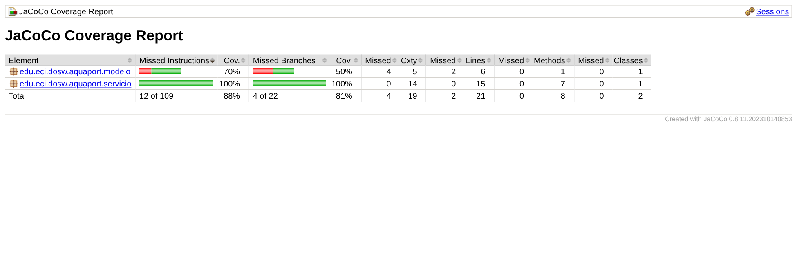

# 12 TDD: ValidadorMision con Red → Green → Refactor

**Nivel:** Piplup · **Herramientas:** JUnit 5 (Jupiter + Params) · patrón AAA · JaCoCo

## El ciclo aplicado (verificable en el historial de commits)

| Fase | Commit | Qué contiene | Resultado |
|---|---|---|---|
| **Red** | `test:Piplup-Punto 12 - Red: pruebas de ValidadorMision` | Solo `ValidadorMisionTest` (20 pruebas). `ValidadorMision` **no existe**. | No compila, por lo tanto todas fallan (resultado esperado). |
| **Green** | `feat:Piplup-Punto 12 - Green: ValidadorMision minimo` | Código mínimo: `if` directos, número mágico `35`, `Set.of(...)` creado en cada llamada, mensajes genéricos. | 20/20 en verde. |
| **Refactor** | `refactor:Piplup-Punto 12 - Refactor: constantes, mensajes y helper` | Constantes `BATERIA_MINIMA` y `ZONAS_VALIDAS`, método privado `requerirDrone` (elimina duplicación del chequeo de `null`), mensajes descriptivos en español, Javadoc. | 20/20 siguen en verde: el comportamiento no cambió. |

Con `git log --oneline -- "12 TDD"` se ve que **el commit de pruebas es anterior al de producción**.

## API del validador

| Método | Regla | Si falla |
|---|---|---|
| `boolean tieneBateriaSuficiente(DroneAcuatico)` | batería ≥ 35 % | `IllegalArgumentException` si el drone es `null` |
| `void validarPuntoLlegada(String)` | no nulo, no vacío, no en blanco | `IllegalArgumentException` |
| `void validarDisponibilidad(DroneAcuatico)` | `disponible == true` | `IllegalStateException` (o `IllegalArgumentException` si es `null`) |
| `void validarZona(String)` | pertenece a las 5 zonas fijas (sensible a mayúsculas) | `IllegalArgumentException` |

Se usa `IllegalArgumentException` cuando **el dato recibido es inválido** e `IllegalStateException` cuando **el dato es válido pero el drone está en un estado que no permite la operación**.

## Pruebas (20 ejecuciones, 15 métodos)

| Grupo | Casos |
|---|---|
| Batería | 85 % válido, 18 % inválido, **35 % (límite) válido**, **34 % (límite) inválido** · drone `null` → excepción |
| Punto de llegada | `null` → excepción · `""` y `"   "` (parametrizada) → excepción · válido → sin excepción |
| Disponibilidad | no disponible → `IllegalStateException` · disponible → sin excepción · `null` → excepción |
| Zona (edge) | las 5 zonas fijas (parametrizada) válidas, “Río Bogotá” inválida, **“embalse norte” en minúsculas** inválida, `null` inválida |

Convenciones:
- Nombre `metodo_condicion_resultadoEsperado` + `@DisplayName` en español.
- **AAA** explícito (`// Arrange`, `// Act`, `// Assert`) en el primer test; en el resto las tres partes están separadas por líneas en blanco.
- **Una sola verificación por prueba**; asserts específicos (`assertTrue/False`, `assertThrows` con el tipo exacto, `assertDoesNotThrow`).
- `@BeforeEach` crea el validador y un método `drone(bateria, disponible)` evita repetir el `new DroneAcuatico(...)`.
- `@ParameterizedTest` + `@ValueSource` para los casos que solo cambian el dato de entrada.

## Cobertura obtenida



`ValidadorMision`: **100 % líneas y 100 % ramas**. El total del proyecto queda en ~90 % porque las validaciones del `record DroneAcuatico` no tienen pruebas propias: eso se corrige en el **punto 13**.

## Ejecutar

```bash
mvn test                              # pruebas
# reporte: target/site/jacoco/index.html
```
