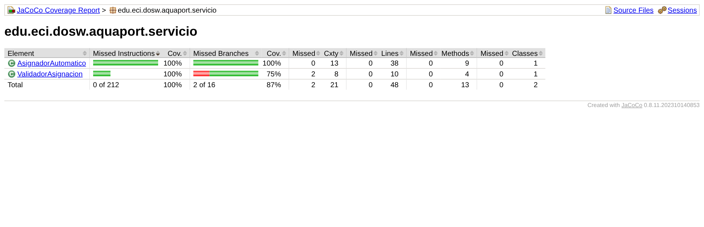

# 12 TDD: AsignadorAutomatico con Red → Green → Refactor y Mockito

**Nivel:** Prinplup · **Herramientas:** JUnit 5, Mockito 5 (`@Mock`, `when/thenReturn`, `thenAnswer`, `verify`, `ArgumentCaptor`), patrón AAA, JaCoCo

En Piplup el ciclo se hizo sobre un validador sin dependencias. Ahora la clase bajo prueba **depende de 4 colaboradores** (estrategia, API de condiciones, validador y publicador). Por eso las pruebas usan **Mockito**: la estrategia y la API se reemplazan por dobles para probar el asignador aislado, sin red y con resultados controlados.

## El ciclo en el historial de commits

| Fase | Commit | Contenido | Resultado |
|---|---|---|---|
| Preparación | `feat:Prinplup-Punto 12 - Agregar dominio e interfaces que usa el asignador` | Modelo, `EstrategiaSeleccion`, `ProveedorCondicionesHidricas`, `ValidadorAsignacion`, Observer y `pom.xml` con Mockito y JaCoCo. | Compila, sin pruebas del asignador. |
| **Red** | `test:Prinplup-Punto 12 - Red: pruebas de AsignadorAutomatico con Mockito` | Solo `AsignadorAutomaticoTest` (11 pruebas). `AsignadorAutomatico` **no existe**. | No compila: las 11 fallan (esperado). |
| **Green** | `feat:Prinplup-Punto 12 - Green: AsignadorAutomatico minimo` | Código mínimo: un `while` que reintenta mientras el elegido esté en FALLO, sin validar parámetros, `asignar` de 25 líneas, `ArrayList` + `sort` y la lista interna retornada sin copia. | 11/11 en verde. |
| **Refactor** | `refactor:Prinplup-Punto 12 - Refactor: extraer elegirEntre, confirmar y sinIncluir` | `asignar` queda en 4 líneas; la reelección por FALLO pasa a `elegirEntre` (recursivo, sin variables reasignadas); `confirmar` agrupa el cambio de estado y el evento; `requireNonNull` con mensajes en español; `sorted(...).toList()` y `List.copyOf`. | 11/11 siguen en verde. |

```bash
git log --oneline -- "12 TDD"
```

muestra que el commit de pruebas es anterior al de producción.

## Pruebas (11)

| # | Prueba | Técnica Mockito |
|---|---|---|
| 1 | Happy path: la misión queda `EN_TRANSITO` | `when(estrategia.seleccionar(...)).thenReturn(Optional.of(drone))` |
| 2 | Happy path: el drone pasa a `EN_MISION` | Igual que 1, verificación de estado |
| 3 | Misión CRÍTICA sin drones: los observadores reciben el evento **una vez** | `verify(observador, times(1)).notificar(argThat(...))` |
| 4 | Drone en FALLO: notifica y asigna un alternativo | `thenAnswer` que devuelve el drone en FALLO la primera vez y el sano la segunda |
| 5 | En el reintento, el drone en FALLO ya no se ofrece a la estrategia | `ArgumentCaptor<List<DroneAcuatico>>` + `times(2)` sobre la segunda lista |
| 6 | Flota vacía: no hay asignación y se publica `MISION_SIN_DRONE` | `verify` del evento |
| 7 | Caso borde: batería **35 %** sí llega a la estrategia | `verify(estrategia).seleccionar(argThat(c -> c.contains(drone)), any())` |
| 8 | Caso borde: batería **34 %** no llega a la estrategia | `verify(estrategia).seleccionar(argThat(List::isEmpty), any())` |
| 9 | La asignación exitosa publica un único `MISION_ASIGNADA` | `ArgumentCaptor<EventoMision>` + `verify(observador).notificar(captor.capture())` |
| 10 | Las CRÍTICAS eligen drone antes que las demás (un solo drone, dos misiones) | `thenAnswer` que devuelve el primer candidato |
| 11 | Un observador removido ya no es notificado | `verify(observador, never())` |

Convenciones:
- Nombres `metodo_condicion_resultadoEsperado` + `@DisplayName` en español.
- **AAA**: explícito con comentarios `// Arrange`, `// Act`, `// Assert` en la primera prueba; en las demás las tres partes van separadas por líneas en blanco.
- `@ExtendWith(MockitoExtension.class)` con modo estricto: un stub que no se usa hace fallar la prueba, así no quedan `when(...)` sobrantes.
- Lo que se simula son **abstracciones** (estrategia, API, observador). El `ValidadorAsignacion` y el `PublicadorEventosMision` son reales: simularlos haría que la prueba no verifique nada del flujo.

## Cobertura



`AsignadorAutomatico`: **100 % líneas y 100 % ramas**.

## Ejecutar

```bash
mvn test        # reporte en target/site/jacoco/index.html
```
