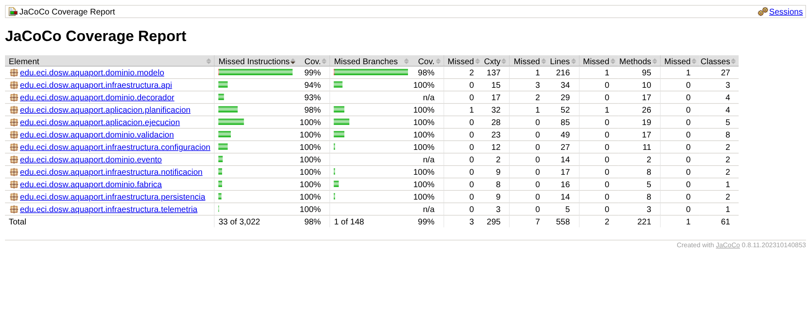
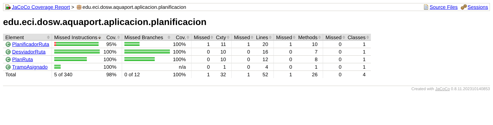

# 12 TDD: Pruebas en 3 capas para AquaPort Enterprise

**Nivel:** Empoleon · Unitarias del dominio y del `PlanificadorRuta` · integración de las 3 capas · los 5 flujos alternos · JaCoCo ≥ 85 % líneas y ≥ 75 % ramas

## Las 3 capas de pruebas

| Capa | Qué prueba | Clases de prueba | Dobles |
|---|---|---|---|
| **Unitarias del dominio** | Reglas puras: batería, capacidad, tramos de la misión, custodia, mapa, cadena de validación, decoradores | `DroneAcuaticoTest`, `MisionRutaTest`, `CadenaCustodiaTest`, `MapaHidricoTest`, `ValoresDominioTest`, `CadenaValidacionTest`, `DecoradoresTest`, `FabricaDronesTest` | Mocks de puertos (`EstadoZonas`, `ProveedorCondicionesHidricas`, `RegistroTelemetria`) |
| **Unitarias de aplicación** | Cada tramo del `PlanificadorRuta`, el desvío, la reasignación y el caso de uso | `PlanificadorRutaTest`, `DesviadorRutaTest`, `PlanRutaTest`, `ReasignadorTramoTest`, `ServicioMisionMultiEtapaTest`, `PublicadorEventosRutaTest` | Mockito para planificador, ejecutor, repositorio y observadores |
| **Integración** | Flujo completo solicitud → planificación → asignación por tramos → notificación de waypoints con las clases reales de las 3 capas | `FlujoMultiEtapaIntegracionTest`, `RendimientoRedTest`, `ClienteHttpAPIHidricaTest` (servidor HTTP local del JDK) | Ninguno: solo la respuesta de la API se fija con un JSON |

## Unitarias del PlanificadorRuta (cada tramo)

| Prueba | Tramo / caso |
|---|---|
| `elegirPara_tramo1_ganaElMasCercano` | Tramo 1 Embalse → Canales: gana AR-01 (60 %, en el Embalse) frente a AR-41 (99 %, en la Laguna) |
| `elegirPara_tramo2_empateDesempataPorBateria` | Tramo 2 Canales → Lab: dos drones en la misma zona, gana el de 90 % |
| `elegirPara_sinAptos_vacio` | Drone en FALLO y drone con 30 %: `Optional.empty()` |
| `planificar_dosTramos_unDroneDistintoPorTramo` | Ruta completa: AR-01 en el tramo 1 y AR-21 en el tramo 2 |
| `planificar_unSoloDrone_planIncompleto` | Un drone para dos tramos: el tramo 2 queda en `sinDrone` |
| `planificar_misionNula_lanzaExcepcion` | Entrada nula |

## Los 5 flujos alternos (todos con prueba)

| Flujo alterno | Prueba de integración | Prueba unitaria |
|---|---|---|
| Fallo de drone en waypoint | `ejecutar_falloEnWaypoint_reasignaYEntrega` y `..._SinReemplazo_fallida` | `ReasignadorTramoTest.droneListo_droneEnFallo_reasigna` |
| Zona destino inactiva | `ejecutar_zonaDestinoInactiva_enEspera` | `ServicioMisionMultiEtapaTest.ejecutar_zonaDestinoInactiva_enEspera` |
| Batería crítica en ruta | `ejecutar_bateriaCriticaEnRuta_reasigna` | `ReasignadorTramoTest.droneListo_bateriaCritica_publicaYReasigna` (mock de `Drone` con 19 %) |
| Cadena de custodia interrumpida | `ejecutar_custodiaInterrumpida_fallida` | `CadenaCustodiaTest` (fuera de orden y sin sello) |
| Condición hídrica adversa | `ejecutar_condicionAdversaEnTramo_desviaRuta` | `DesviadorRutaTest.tramosSeguros_canalAdverso_desviaPorIntermedia` |

En la integración, el fallo y la batería crítica se provocan con un observador que actúa justo cuando llega el evento `WAYPOINT_ALCANZADO` del tramo 1: es el momento real en que un drone espera en el waypoint.

## Red → Green → Refactor en el historial

```bash
git log --oneline -- "12 TDD"
```

| Fase | Commit | Estado |
|---|---|---|
| Preparación | `feat(empoleon-12): agregar el dominio y los puertos sobre los que se construye el planificador` | Compila, sin `PlanificadorRuta` |
| **Red** | `test(empoleon-12): red de PlanificadorRuta por tramo antes del código` | No compila: las pruebas usan una clase que no existe |
| **Green** | `feat(empoleon-12): green de PlanificadorRuta con la lógica mínima` | Pasa. Código mínimo: `for` anidados, una variable `mejor` que empieza en `null`, `ArrayList` de usados que se modifica en el ciclo |
| **Refactor** | `refactor(empoleon-12): planificar con reduce y elegir el drone con streams` | Sigue pasando. `reduce` con `PlanRuta` inmutable, `min(porCercania.thenComparing(bateria))`, sin `null`, `requireNonNull` en el constructor |
| **Red** (2.º ciclo) | `test(empoleon-12): red de los 5 flujos alternos y del flujo integrado` | No compila: faltan ejecución e infraestructura |
| **Green** (2.º ciclo) | `feat(empoleon-12): implementar ejecución, reasignación e infraestructura para los flujos alternos` | Pasa |
| Cobertura | `test(empoleon-12): pruebas del dominio y la infraestructura para cubrir ramas` | ≥ 85 % / ≥ 75 % |

## Cobertura





**98 % de líneas y 99 % de ramas** (umbral 85 % / 75 %). Lo único sin cubrir es defensivo y no se puede alcanzar desde una prueba normal: el combinador `soloSecuencial` del `reduce` (el stream nunca es paralelo), la rama `NoSuchAlgorithmException` del sello (toda JVM trae SHA-256) y la de `InterruptedException` del cliente HTTP.

## Convenciones

- `metodo_condicion_resultadoEsperado` + `@DisplayName` en español.
- AAA explícito con comentarios `// Arrange`, `// Act`, `// Assert` en la prueba principal de `DroneAcuaticoTest`, `PlanificadorRutaTest` y `CadenaValidacionTest`; en las demás las tres partes van separadas por línea en blanco.
- Mockito en modo estricto (`MockitoExtension`): un `when` que no se usa hace fallar la prueba.
- Lo que se simula son **puertos y colaboradores**; las reglas del dominio siempre son reales.

```bash
mvn verify      # 103 pruebas + regla de JaCoCo
```
