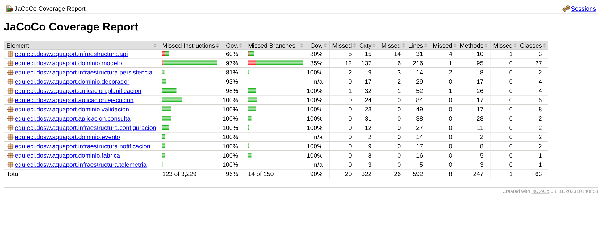
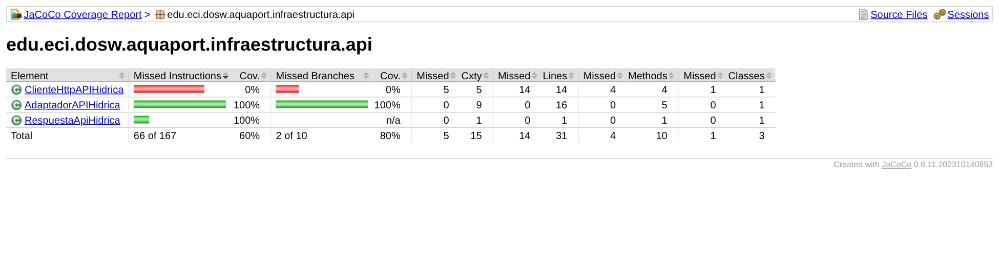
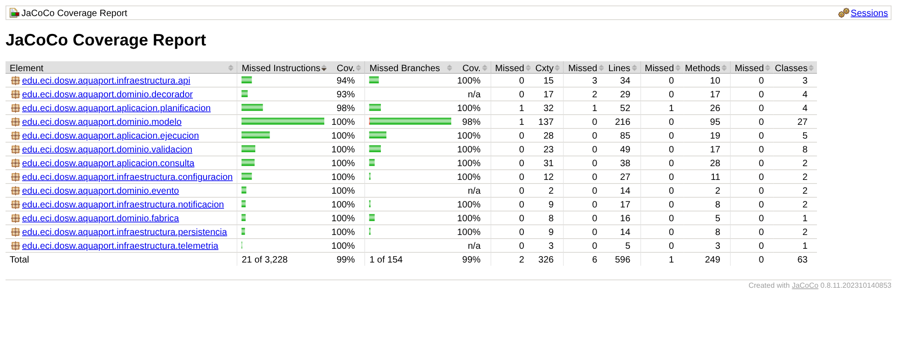

# 13 JaCoCo + SonarQube: Estándares de calidad de producción

**Nivel:** Empoleon · JaCoCo ≥ 85 % líneas y ≥ 75 % ramas · SonarQube: 0 bugs, 0 vulnerabilidades, deuda < 15 min, duplicación < 3 %

## Evolución de los estándares

| Métrica | Piplup | Prinplup | **Empoleon** |
|---|---|---|---|
| Cobertura de líneas | 80 % | 80 % (por clase) | **≥ 85 %** |
| Cobertura de ramas | - | ≥ 80 % por clase (decisión del equipo; el reto pedía 70 %) | **≥ 75 %** |
| Bugs / vulnerabilidades | 0 / 0 | 0 / 0 | **0 / 0** |
| Deuda técnica | 0 | < 30 min | **< 15 min** |
| Duplicación | - | < 5 % | **< 3 %** |

## Quality gate de JaCoCo (`pom.xml`)

```xml
<rule>
    <element>BUNDLE</element>
    <limits>
        <limit><counter>LINE</counter><value>COVEREDRATIO</value><minimum>0.85</minimum></limit>
        <limit><counter>BRANCH</counter><value>COVEREDRATIO</value><minimum>0.75</minimum></limit>
    </limits>
</rule>
```

Se excluyen solo las clases `*App` (los `main` de demostración); todo lo demás, incluida la infraestructura, cuenta. `mvn verify` falla si cualquiera de los dos límites no se cumple.

## Quality gate Enterprise en SonarQube

**Quality Gates → Create** → `AquaPort Enterprise`, condiciones sobre *Overall Code*, y asignarlo en **Project Settings → Quality Gate**:

| Indicador | Operador | Valor |
|---|---|---|
| Coverage | is less than | 85 |
| Condition Coverage | is less than | 75 |
| Bugs | is greater than | 0 |
| Vulnerabilities | is greater than | 0 |
| Technical Debt | is greater than | 15 min |
| Duplicated Lines (%) | is greater than | 3 |

```bash
docker compose up -d
mvn clean verify sonar:sonar -Dsonar.token=TU_TOKEN     # projectKey aquaport-empoleon
```

## Antes: el proyecto integrado



Al integrar la v3 (commit `feat(empoleon-13): integrar la v3 completa con el quality gate de JaCoCo`) el total ya pasaba el umbral (96 % de instrucciones, 90 % de ramas), pero el reporte por paquete mostró un hueco que el total escondía:



`ClienteHttpAPIHidrica` estaba en **0 %**: ninguna prueba hablaba por HTTP. Es justo la clase que falla en producción cuando el proveedor se cae. Un umbral global alto no garantiza que lo riesgoso esté probado.

## Issues encontrados y cómo se resolvieron (un commit cada uno)

| # | Issue | Causa raíz | Corrección | Commit |
|---|---|---|---|---|
| 1 | **Cobertura**: `ClienteHttpAPIHidrica` 0 %, `RepositorioMisionesEnMemoria` y `EstadoZonasEnMemoria` parciales, valores límite del dominio sin prueba | Las pruebas se escribieron para la lógica y no para los adaptadores | `ClienteHttpAPIHidricaTest` con un `HttpServer` local del JDK (200, 503 y servidor caído), `PersistenciaEnMemoriaTest`, `ObservadoresTest`, `ValoresDominioTest`, `PlanRutaTest` y `RendimientoRedTest` | `test(empoleon-13): cubrir el cliente HTTP, la persistencia y los valores límite del dominio` |
| 2 | **java:S2142** *InterruptedException should not be ignored* (Bug) | `catch (IOException \| InterruptedException e)` convertía la interrupción en un error de IO y el hilo perdía su marca de interrupción | Dos `catch`: `IOException` → `UncheckedIOException`; `InterruptedException` → `Thread.currentThread().interrupt()` y luego la excepción | `fix(empoleon-13): restaurar la interrupción del hilo en ClienteHttpAPIHidrica` |
| 3 | **java:S1125** *Boolean literals should not be redundant* | `estaSellado()` retornaba `sello.isBlank() ? false : true` | `return !sello.isBlank();` | `refactor(empoleon-13): simplificar estaSellado sin literales booleanos` |
| 4 | **Método de 25 líneas** (límite del revisor: 15) y bloque de “misión fallida” repetido dos veces | `EjecutorRuta.ejecutar` hacía el recorrido, la custodia, la publicación de eventos y el cierre en un solo método | `ejecutar` (11 líneas) delega en `recorrerYCustodiar` y `terminar`; el bloque de fallo queda en un solo lugar | `refactor(empoleon-13): dividir EjecutorRuta.ejecutar en recorrer y terminar` |

Cada commit explica en su cuerpo la causa raíz, la corrección y por qué es la adecuada. Ningún issue se suprimió con `@SuppressWarnings` ni con `//NOSONAR`.

## Después



**99 % de líneas y 99 % de ramas**, 110 pruebas. Lo que queda sin cubrir es código defensivo inalcanzable (combinador de un `reduce` secuencial y la rama `NoSuchAlgorithmException` de SHA-256).

**Pendiente:** correr el análisis en SonarQube y guardar la captura del dashboard con los 6 indicadores en verde en `evidencias/04-sonarqube-dashboard.png`. Si el servidor reporta otro issue (las reglas dependen de la versión), se corrige con un commit nuevo siguiendo la tabla.
