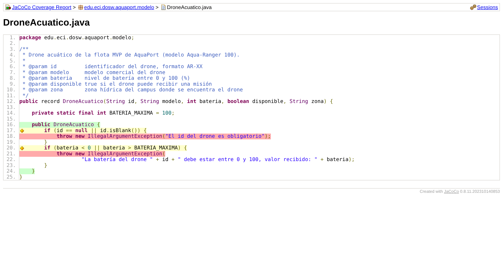
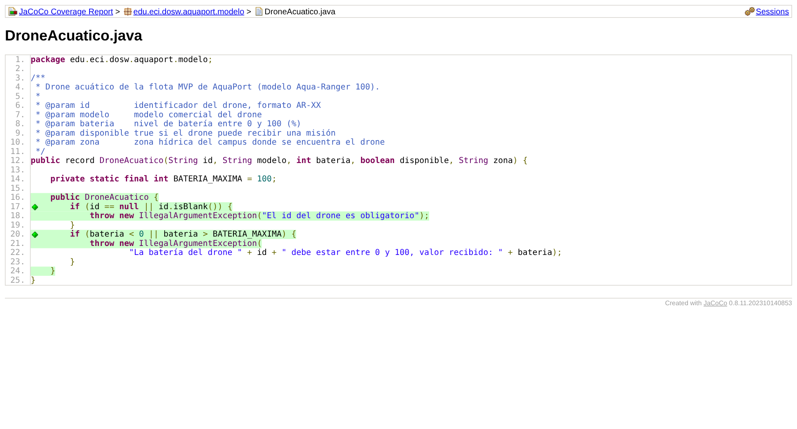
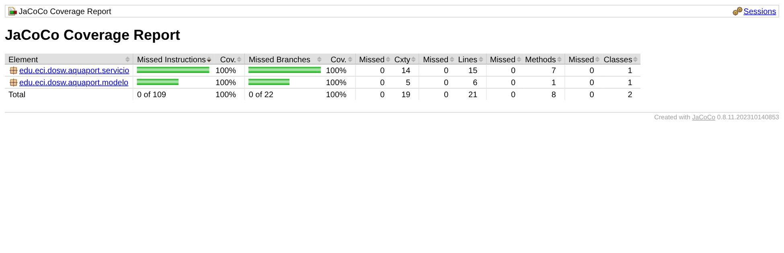

# 13 JaCoCo: Medir la cobertura del ValidadorMision

**Nivel:** Piplup · **Meta:** ≥ 80 % line coverage, sin ramas sin cubrir

## Configuración en `pom.xml`

```xml
<plugin>
    <groupId>org.jacoco</groupId>
    <artifactId>jacoco-maven-plugin</artifactId>
    <version>0.8.11</version>
    <executions>
        <execution><goals><goal>prepare-agent</goal></goals></execution>
        <execution>
            <id>report</id>
            <phase>test</phase>
            <goals><goal>report</goal></goals>
        </execution>
        <execution>                        <!-- falla el build si baja del 80 % -->
            <id>check</id>
            <phase>verify</phase>
            <goals><goal>check</goal></goals>
            <configuration>
                <rules><rule>
                    <element>BUNDLE</element>
                    <limits><limit>
                        <counter>LINE</counter><value>COVEREDRATIO</value><minimum>0.80</minimum>
                    </limit></limits>
                </rule></rules>
            </configuration>
        </execution>
    </executions>
</plugin>
```

- `prepare-agent` engancha el agente de JaCoCo a la JVM de las pruebas.
- `report` (fase `test`) genera `target/site/jacoco/index.html`.
- `check` (fase `verify`) convierte la meta del 80 % en una regla: si alguien borra pruebas, `mvn verify` falla.

## Lectura del reporte y corrección

**1. Primer análisis (código del punto 12):** `ValidadorMision` al 100 %, pero `DroneAcuatico` mostraba líneas **rojas** (las dos `throw` nunca se ejecutaban) y condiciones **amarillas** (solo se probaba un lado del `||`).



**2. Pruebas agregadas** en `src/test/.../modelo/DroneAcuaticoTest.java`: id `null`, id en blanco, batería −1 y 101 (fuera de rango) y batería 0 y 100 (límites válidos).

**3. Resultado:**





| Clase | Líneas | Ramas |
|---|---|---|
| `ValidadorMision` | **100 %** (15/15) | **100 %** (14/14) |
| `DroneAcuatico` | **100 %** (6/6) | **100 %** (8/8) |
| **Total** | **100 %** (21/21) | **100 %** (22/22) |

27 pruebas en verde. El detalle línea a línea del validador está en `evidencias/jacoco-validador-fuente.png` y el reporte HTML completo en `evidencias/reporte-jacoco-html/index.html`.

## Cómo leer los colores

| Color | Significa | Acción |
|---|---|---|
| Verde | Línea o rama cubierta | Bien |
| Amarillo | Rama parcialmente cubierta (falta el otro camino del `if`) | Agregar la prueba del camino faltante |
| Rojo | Nunca ejecutada | Escribir la prueba o eliminar código muerto |

## Ejecutar

```bash
mvn verify          # pruebas + reporte + regla del 80 %
# abrir target/site/jacoco/index.html
```

> Las capturas de `evidencias/` se generaron con JaCoCo 0.8.11 sobre este mismo código. Si el profesor pide la captura tomada en su propio equipo, basta con correr `mvn verify` y abrir el reporte: los números deben coincidir.
