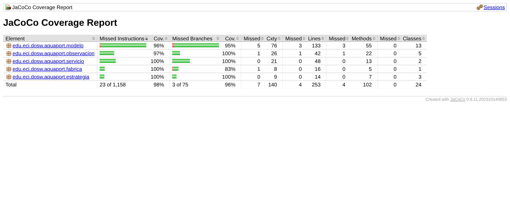
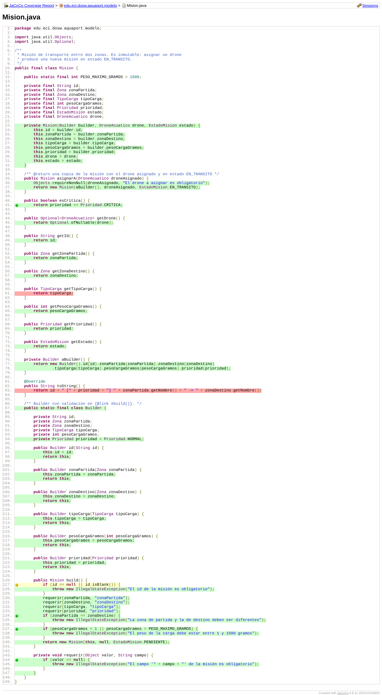
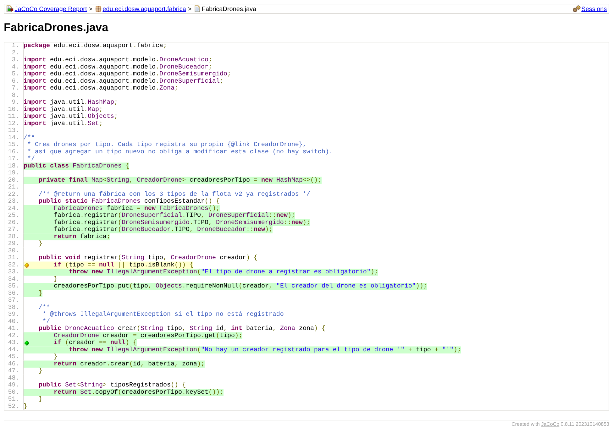
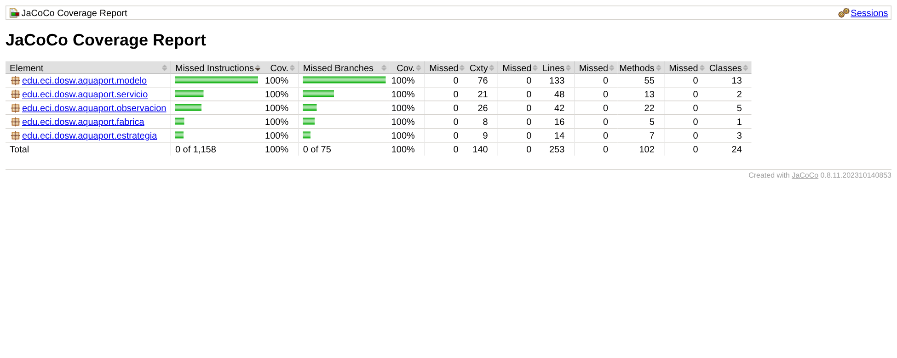

# 13 JaCoCo: Cobertura por clase y ramas amarillas

**Nivel:** Prinplup · **Herramienta:** JaCoCo 0.8.11 · **Regla:** ≥ 80 % de líneas en el total **y** ≥ 80 % de líneas y de ramas **en cada clase**

En Piplup la regla era solo de líneas sobre el total del proyecto. Con esa regla un proyecto puede pasar con un 90 % global mientras una clase importante tiene un 40 %. Por eso en Prinplup la regla también se aplica **por clase** y **por ramas**.

## Configuración (`pom.xml`)

```xml
<execution>
    <id>check</id>
    <phase>verify</phase>
    <goals><goal>check</goal></goals>
    <configuration>
        <rules>
            <rule>
                <element>BUNDLE</element>
                <limits>
                    <limit><counter>LINE</counter><value>COVEREDRATIO</value><minimum>0.80</minimum></limit>
                </limits>
            </rule>
            <rule>
                <element>CLASS</element>
                <limits>
                    <limit><counter>LINE</counter><value>COVEREDRATIO</value><minimum>0.80</minimum></limit>
                    <limit><counter>BRANCH</counter><value>COVEREDRATIO</value><minimum>0.80</minimum></limit>
                </limits>
            </rule>
        </rules>
    </configuration>
</execution>
```

`mvn verify` **falla** si una sola clase baja del 80 % en líneas o en ramas. Así la regla es parte del build y no una revisión manual del reporte.

## Antes: 98 % de instrucciones y 96 % de ramas



El total pasaba la regla con holgura, pero al abrir clase por clase aparecieron **ramas amarillas** (una condición con dos caminos donde solo se probó uno) y líneas rojas.

| Clase | Línea | Código | Qué faltaba |
|---|---|---|---|
| `Mision.Builder` | 127 | `if (id == null \|\| id.isBlank())` | Solo se probó `id == null`; nunca un id en blanco (`"   "`). |
| `DroneAcuatico` | 21 | `if (id == null \|\| id.isBlank())` | Solo se probó el id en blanco; nunca el id nulo. |
| `FabricaDrones` | 32 | `if (tipo == null \|\| tipo.isBlank())` | Solo se probó el tipo vacío; nunca el tipo nulo. |
| `Mision` | 61, 83 | `getTipoCarga()`, `toString()` | Líneas rojas: ninguna prueba las ejecutaba. |
| `DroneAcuatico` | - | `getModelo()` | Línea roja. |
| `PublicadorEventosMision` | - | `cantidadObservadores()` | Línea roja. |





## Por qué importan las ramas amarillas

Con `||` Java evalúa la segunda condición solo si la primera es falsa. Si las pruebas siempre mandan `null`, la parte `isBlank()` **nunca se ejecuta**: si alguien la borra por error, todas las pruebas siguen en verde y el sistema acepta misiones con id `"   "`. La cobertura de líneas marca la línea en verde aunque medio `if` no esté probado; la de ramas no.

## Pruebas agregadas

| Prueba | Cubre |
|---|---|
| `MisionTest`: “Un id en blanco lanza IllegalStateException (rama id.isBlank())” | Rama amarilla de `Mision.Builder` |
| `DroneAcuaticoTest`: “No se puede crear un drone con id nulo (rama id == null)” | Rama amarilla de `DroneAcuatico` |
| `FabricaDronesTest`: “Registrar un tipo nulo lanza IllegalArgumentException (rama tipo == null)” | Rama amarilla de `FabricaDrones` |
| `MisionTest`: “Asignar un drone conserva el tipo de carga de la misión original” | `getTipoCarga()` y además verifica que `asignarA` no pierda datos |
| `MisionTest`: “La representación en texto muestra la prioridad” | `toString()` |
| `DroneAcuaticoTest`: “Cada tipo informa su modelo comercial” | `getModelo()` |
| `ObservadoresTest`: “El publicador cuenta los observadores registrados” | `cantidadObservadores()` |

Ninguna prueba se escribió solo para pintar de verde: cada una verifica un comportamiento con un `assert` específico.

## Después: 100 % de instrucciones, líneas y ramas



75 pruebas (incluida `RendimientoAsignacionTest`, el RNF-01 del punto 06), todas las clases en 100 %.

## Qué no se excluyó

No hay `<excludes>` en este punto: todas las clases del dominio cuentan. En el punto 14 solo se excluyen de la cobertura `AquaPortApp` (el `main` de demostración) y `FlotaEjemplo` (datos de ejemplo), que no tienen lógica propia.

## Ejecutar

```bash
mvn verify      # pruebas + reporte + regla (falla si alguna clase < 80 %)
# reporte: target/site/jacoco/index.html
```
